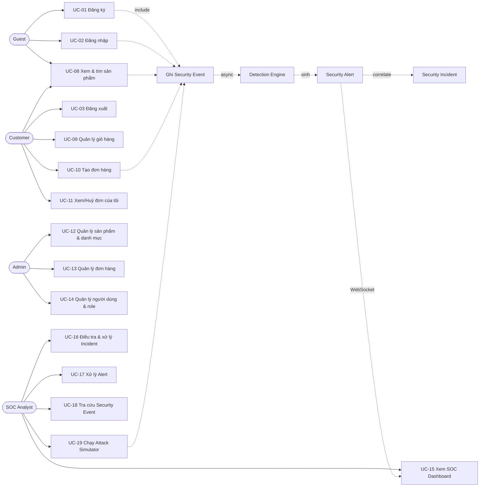
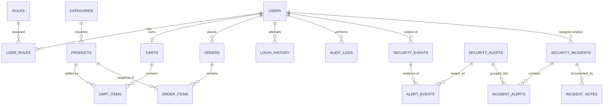

# PHASE 0 — PROJECT PLANNING
## Mini SOC Dashboard — E-Commerce Security Monitoring System

| | |
|---|---|
| **Document ID** | `PHASE-0-PLANNING` |
| **Version** | 1.0 |
| **Ngày** | 2026-09-21 |
| **Trạng thái** | ⏳ **Chờ bạn phê duyệt** (Phase 0 chưa viết code — theo SDD §23) |
| **Phase tiếp theo** | Phase 1 — Project Initialization |
| **Tham chiếu** | SDD v1.0 (Mini SOC Dashboard — E-Commerce Security Monitoring System) |
| **Ngôn ngữ** | Giải thích tiếng Việt, code/tên class/thuật ngữ giữ tiếng Anh |

---

## 0. HƯỚNG DẪN ĐỌC TÀI LIỆU NÀY

### 0.1. Quy ước ID (traceability)

Toàn bộ tài liệu dùng ID để **truy vết yêu cầu → phase → test**. Đây là kỹ năng bắt buộc của một Software Architect: mỗi dòng code sau này phải trả lời được câu hỏi *"code này tồn tại để thoả mãn yêu cầu nào?"*.

| Prefix | Ý nghĩa | Ví dụ |
|---|---|---|
| `FR-<MODULE>-nn` | Functional Requirement | `FR-DET-02` = rule Brute Force |
| `NFR-<CAT>-nn` | Non-functional Requirement | `NFR-CONC-01` = thread-safety |
| `UC-nn` | Use Case | `UC-16` = điều tra Incident |
| `ADR-nn` | Architecture Decision Record | `ADR-004` = dùng sliding window in-memory |
| `R-nn` | Risk | `R-02` = sai sót đồng bộ trong detection |
| `D-n` | Open Decision (cần bạn chốt) | `D-1` = chọn version Spring Boot |

### 0.2. Mức ưu tiên (MoSCoW)

`MUST` (bắt buộc, không có là fail) · `SHOULD` (nên có, ảnh hưởng điểm) · `COULD` (làm nếu còn thời gian) · `WON'T` (chủ động **không** làm trong học kỳ này — ghi ra để chứng minh có cân nhắc, không phải quên).

### 0.3. Nguyên tắc làm việc (theo SDD §20, §21)

1. Mỗi lần **chỉ một phase**, không nhảy phase.
2. Với mỗi class/file tôi sẽ trình bày theo 7 bước (§19): *mục đích → layer → dependency → Java concept → lý do chọn cách làm → code → cách chạy/test*.
3. Kết thúc mỗi phase tôi **dừng lại, tóm tắt, chờ bạn xác nhận**.
4. Có lỗi → sửa lỗi hiện tại trước, không thêm feature mới.
5. Tuyệt đối không tạo code giả, không `TODO` thay cho chức năng chính.
6. Cái gì bạn cần tự làm (chạy `mvn`, tạo DB, chụp screenshot) tôi sẽ nói rõ và đưa **lệnh copy-paste được**.

### 0.4. Từ điển thuật ngữ (sẽ dùng lại suốt dự án)

| Thuật ngữ | Nghĩa ngắn gọn | Trong dự án này |
|---|---|---|
| **SOC** | Security Operations Center — trung tâm giám sát & xử lý sự cố bảo mật | Chính là dashboard ta xây |
| **SIEM** | Security Information & Event Management — thu thập log + tương quan + cảnh báo | Ta xây "mini-SIEM" thu nhỏ |
| **Event** | Một hành động đã xảy ra, ghi lại dạng dữ liệu (**facts**, chưa phán xét) | `SecurityEvent` (`LOGIN_FAILED`, `ORDER_CREATED`…) |
| **Detection Rule** | Quy tắc "mẫu hành vi đáng ngờ" áp lên các Event | `BruteForceRule`, `SqlInjectionRule`… |
| **Alert** | Kết luận của Rule: "có gì đó đáng ngờ" (**judgement**) | `SecurityAlert` (`BRUTE_FORCE`, `HIGH`) |
| **Incident** | Nhóm nhiều Alert liên quan thành **một vụ việc cần điều tra** | `SecurityIncident` (`#INC-0001`) |
| **Correlation** | Gom Alert rời rạc thành Incident theo tiêu chí (IP, thời gian, type) | `IncidentCorrelationService` |
| **False Positive** | Cảnh báo sai, thực tế không phải tấn công | Có trạng thái `FALSE_POSITIVE` riêng |
| **Severity** | Mức độ nghiêm trọng của Alert/Incident | `LOW / MEDIUM / HIGH / CRITICAL` |
| **Ingestion** | Quá trình "nạp" event vào hệ thống | Filter → Queue → Worker |
| **Sliding window** | Cửa sổ thời gian trượt (ví dụ "60 giây gần nhất") | Dùng cho Brute Force & Flood |
| **Idempotency** | Gọi lại cùng thao tác không tạo kết quả trùng | Chống tạo alert/incident trùng |
| **Backpressure** | Cơ chế tự hãm khi hệ thống quá tải | Bounded queue + `CallerRunsPolicy` |
| **RBAC** | Role-Based Access Control — phân quyền theo vai trò | `CUSTOMER / ADMIN / SOC_ANALYST` |
| **DTO** | Data Transfer Object — object chỉ để mang dữ liệu qua ranh giới layer | `ProductRequest`, `AlertResponse` |
| **DI / IoC** | Dependency Injection / Inversion of Control — Spring tự "tiêm" object phụ thuộc | `@Service`, constructor injection |

---

## 1. PROJECT OVERVIEW

### 1.1. Một câu mô tả

> Một **website bán hàng trực tuyến nhỏ** (Java + Spring Boot + PostgreSQL) đóng vai **môi trường sinh ra security events**, kèm một **Mini SOC (Security Operations Center)** có khả năng **thu thập – phát hiện – cảnh báo – tương quan – điều tra – hiển thị gần realtime**, cộng thêm **Attack Simulator** để tạo tình huống tấn công phục vụ demo và kiểm thử.

### 1.2. Hai hệ thống con, một ứng dụng

```
┌───────────────────────────────────────────────────────────────────────────┐
│                      MINI SOC DASHBOARD (1 Spring Boot app)               │
│                                                                           │
│   ┌───────────────────────────────┐      ┌─────────────────────────────┐  │
│   │  HỆ THỐNG 1: E-COMMERCE       │      │  HỆ THỐNG 2: MINI SOC       │  │
│   │  (môi trường mô phỏng)        │      │  (trọng tâm dự án)          │  │
│   │                               │      │                             │  │
│   │  • Đăng ký / đăng nhập        │      │  • Security Event Collector │  │
│   │  • Danh mục & sản phẩm        │      │  • Detection Engine + Rules │  │
│   │  • Giỏ hàng                   │─────▶│  • Security Alerts          │  │
│   │  • Đơn hàng + trạng thái      │ sự    │  • Incident Correlation     │  │
│   │  • Quản trị (ADMIN)           │ kiện  │  • SOC Dashboard + Charts   │  │
│   └───────────────────────────────┘      │  • WebSocket realtime       │  │
│                                          │  • Attack Simulator         │  │
│                                          └─────────────────────────────┘  │
│                             Cùng 1 PostgreSQL, cùng 1 JVM                 │
└───────────────────────────────────────────────────────────────────────────┘
```

**Vì sao gộp một ứng dụng thay vì 2 service?** (đây là ADR-001)
* **Ưu điểm khi gộp**: một `pom.xml`, một lần chạy, không cần message broker, không cần HTTP client giữa 2 service, debug đơn giản — phù hợp một sinh viên học Java và một học kỳ.
* **Nhược điểm**: e-commerce và SOC chia sẻ transaction/thread pool; về nguyên tắc hệ thống thật nên tách ingest service riêng.
* **Quyết định**: gộp, **nhưng** giữ ranh giới bằng **interface** (`SecurityEventCollector`, `AlertPublisher`) để sau này có thể tách ra mà không phải viết lại business logic. Đây chính là cách "abstraction" tạo giá trị thật, chứ không phải abstraction cho đẹp.

### 1.3. Phạm vi

**Trong phạm vi** (in-scope)

* E-commerce cơ bản: Auth, Category/Product, Cart, Order (6 trạng thái), trang ADMIN.
* Security event pipeline đầy đủ (ingest → detect → alert → correlate → incident → dashboard).
* 5 detection rules, 5 simulator, dashboard realtime qua WebSocket/STOMP.
* Flyway migrations, unit test với JUnit 5 + Mockito, logging với SLF4J/Logback.
* Docker Compose **chỉ cho PostgreSQL** (ứng dụng vẫn chạy bằng Maven/Java theo SDD §13).

**Ngoài phạm vi** (out-of-scope — ghi rõ để không bị trừ điểm vì "thiếu")

* Thanh toán thật, vận chuyển thật, email/SMS thật.
* Machine Learning / anomaly detection theo thuật toán phức tạp.
* Multi-tenant, clustering, Kafka/Redis/Elasticsearch (đã bị cấm hoặc quá nặng cho học kỳ).
* Tấn công thật ra hệ thống bên ngoài (bất hợp pháp — xem §13 R-13).
* Mobile app, microservices, Kubernetes.

---

## 2. PROBLEM STATEMENT

### 2.1. Bối cảnh

Website thương mại điện tử là mục tiêu hấp dẫn: có tài khoản người dùng (để **credential stuffing / brute force**), có form tìm kiếm và tham số URL (để **SQL injection / XSS**), có luồng đặt hàng (để **gian lận, spam đơn**), và có trang quản trị (để **leo thang đặc quyền**).

### 2.2. Vấn đề cần giải quyết

1. **Log rời rạc không tạo ra tri thức bảo mật.** Một dòng `WARN Login failed` không nói lên điều gì; *500 lần fail từ cùng một IP trong 60 giây* mới là tấn công. Cần một lớp **biến log hành vi thành tín hiệu bảo mật có cấu trúc** (SecurityEvent — có `sourceIp`, `eventType`, `occurredAt` chuẩn hoá, truy vấn được).
2. **Không có cơ chế phán đoán tự động.** Con người không thể đọc từng event. Cần **Detection Engine** với các rule tường minh, có ngưỡng, có unit test — tức là *logic phán đoán là code, không phải cảm tính*.
3. **Cảnh báo rời rạc gây "alert storm".** 200 alert cùng một IP không phải 200 sự cố. Cần **correlation** gom thành **Incident** + cơ chế **khử trùng lặp (dedup)** để analyst làm việc được.
4. **Thiếu nơi để "nhìn thấy" và xử lý.** Cần dashboard gần realtime + quy trình nghiệp vụ: tiếp nhận → điều tra → ghi chú → kết luận (resolve / false positive).

### 2.3. Vì sao phải tự xây, không dùng công cụ có sẵn?

Vì mục tiêu của môn **Lập trình Java nâng cao**: chính **quá trình** viết luồng event, viết rule, xử lý đồng bộ (concurrency), thiết kế tầng, giao dịch DB, phân quyền — mới là thứ cần học. Dùng ELK/Wazuh sẽ cho ra sản phẩm "chạy được" nhưng không chứng minh được kiến thức Java. (Ngoài ra các hệ thống đó cần nhiều RAM/container, không phù hợp máy sinh viên.)

---

## 3. OBJECTIVES

### 3.1. Mục tiêu sản phẩm (đo lường được)

| ID | Mục tiêu | Tiêu chí đạt (Definition of Success) |
|---|---|---|
| `OBJ-1` | Vận hành được luồng thương mại điện tử cơ bản | Một CUSTOMER tự đăng ký → tìm sản phẩm → thêm giỏ → đặt hàng → xem đơn; ADMIN đổi trạng thái tới `COMPLETED` |
| `OBJ-2` | Mọi hành động quan trọng đều sinh Security Event | ≥ 12 event type được sinh tự động, kiểm chứng bằng bảng `security_events` sau khi thao tác |
| `OBJ-3` | Phát hiện được 5 loại hành vi tấn công | 5 rule có unit test riêng + chạy được qua Simulator, sinh alert đúng type/severity |
| `OBJ-4` | Gom alert thành incident có thể điều tra | Alert cùng IP được gom vào 1 incident; analyst gán, ghi chú, resolve được trên UI |
| `OBJ-5` | Dashboard gần realtime, không cần F5 | Trong ≤ 3 giây sau khi alert được tạo, browser nhận được thông báo qua WebSocket |
| `OBJ-6` | Demo tấn công an toàn, lặp lại được | 1 nút bấm ra kịch bản Brute Force → alert `HIGH` → incident → xử lý xong |

### 3.2. Mục tiêu học tập (map tới yêu cầu §12 SDD)

| Kiến thức Java nâng cao | Thể hiện ở đâu trong dự án |
|---|---|
| **OOP: Encapsulation / Inheritance / Polymorphism / Abstraction** | `BaseEntity` (id, createdAt, `@Version`) → kế thừa bởi entity; `SecurityRule` interface → 5 implementation đa hình; `SecurityEventType` enum có hành vi |
| **Interface & DI** | `SecurityEventCollector`, `DetectionEngine`, `AlertPublisher` đều là interface; Spring inject implementation |
| **Collections** | `List<SecurityRule>` (rule registry), `Map<String, Deque<Instant>>` (sliding window), `Queue` (event buffer), `Set` (dedup IP), `EnumMap` (thống kê dashboard) |
| **Streams & Lambda** | Tổng hợp KPI dashboard, group-by thống kê, `Comparator` sắp xếp alert |
| **Generics** | `Page<T>`, `Optional<T>`, `RuleResult<T>`/generic response |
| **Exception handling** | Custom exception (`UserNotFoundException`…), `@ControllerAdvice` global handler |
| **Multithreading** | `ThreadPoolExecutor` bounded queue cho ingest; `ScheduledExecutorService` cho eviction + retention; `CompletableFuture` cho thống kê dashboard; `Clock` để test được thời gian |
| **JDBC/JPA/Hibernate** | Spring Data JPA, `@Entity` mapping, JPQL/native query cho thống kê, optimistic locking `@Version` |
| **Transaction** | `@Transactional` ở tầng service; tạo order là 1 transaction (trừ stock + tạo order + tạo order_items) |
| **Security** | Spring Security, BCrypt, RBAC, CSRF, session, ownership check |
| **Testing** | JUnit 5 + Mockito; test rule với `Clock` giả; test concurrency |
| **Design Patterns** | Strategy (rules), Factory (alert), Observer (event→alert→websocket), Builder (test data/DTO), Template Method (simulator base) |

---

## 4. ACTORS

| # | Actor | Loại | Mục tiêu chính | Quyền (Role) | Xuất hiện từ |
|---|---|---|---|---|---|
| A1 | **Guest** | Người | Xem sản phẩm, đăng ký, đăng nhập | (chưa đăng nhập) | Phase 3–4 |
| A2 | **Customer** | Người | Mua hàng: giỏ, đặt đơn, xem/huỷ đơn của mình | `CUSTOMER` | Phase 3–4 |
| A3 | **Admin** | Người | Quản trị catalog, đơn hàng, người dùng | `ADMIN` | Phase 3–4, 8 |
| A4 | **SOC Analyst** | Người | Theo dõi dashboard, điều tra alert/incident, kết luận | `SOC_ANALYST` | Phase 7–9 |
| A5 | **Attacker (mô phỏng)** | Hệ thống (giả lập) | Gây ra hành vi xấu để hệ thống phát hiện | — (không có tài khoản) | Phase 11 |
| A6 | **Security Event Collector** | Hệ thống | Thu thập mọi hành động thành event | — | Phase 5 |
| A7 | **Detection Engine** | Hệ thống | Chạy rule, sinh alert | — | Phase 6 |
| A8 | **Incident Correlator** | Hệ thống | Gom alert thành incident | — | Phase 8 |
| A9 | **Scheduler / Background Worker** | Hệ thống | Eviction cửa sổ, dọn dữ liệu cũ, tổng hợp thống kê | — | Phase 5, 9 |

> **Ghi chú kiến trúc:** A6–A9 là **system actors** — chúng cũng "hành động" và cũng cần được thiết kế, log, và đôi khi cần cả authorization (ví dụ simulator chỉ ADMIN/SOC_ANALYST gọi được). Sinh viên hay quên nhóm actor này.

---

## 5. FUNCTIONAL REQUIREMENTS

### 5.1. Authentication & Authorization (`AUTH`)

| ID | Yêu cầu | Ưu tiên | Actor | Phase |
|---|---|---|---|---|
| FR-AUTH-01 | Đăng ký tài khoản mới (username, email, password, confirm) với Bean Validation | MUST | A1 | 3 |
| FR-AUTH-02 | Đăng nhập bằng form (username + password) | MUST | A1 | 3 |
| FR-AUTH-03 | Đăng xuất, huỷ session | MUST | A2,A3,A4 | 3 |
| FR-AUTH-04 | Mật khẩu lưu bằng BCrypt, không bao giờ plaintext | MUST | — | 3 |
| FR-AUTH-05 | Phân quyền theo 3 role: CUSTOMER / ADMIN / SOC_ANALYST | MUST | A2–A4 | 3 |
| FR-AUTH-06 | Chặn truy cập sai quyền → 403 + sinh event `ACCESS_DENIED` | MUST | — | 3, 5 |
| FR-AUTH-07 | Đổi mật khẩu (phải nhập mật khẩu hiện tại) → event `PASSWORD_CHANGED` | SHOULD | A2–A4 | 5 |
| FR-AUTH-08 | ADMIN tạo/khoá tài khoản, gán role | SHOULD | A3 | 8 |
| FR-AUTH-09 | Ghi `login_history` cho mọi lần đăng nhập | MUST | — | 5 |
| FR-AUTH-10 | Soft-lockout sau N lần sai | **WON'T** | — | — |

> **Vì sao `FR-AUTH-10` = WON'T?** Nếu tự khoá tài khoản sau 5 lần sai, cuộc tấn công brute force bị chặn **trước khi** detection engine kịp phát hiện → demo sẽ không còn dữ liệu. Trong dự án này, *phát hiện* là mục tiêu. Giải pháp chặn thật (rate limit, lockout) được ghi nhận là future work. Đây là ví dụ của việc **thiết kế để quan sát được (observability-first)**, một đánh đổi có chủ đích.

### 5.2. Catalog (`CAT`/`PROD`), Cart, Order

| ID | Yêu cầu | Ưu tiên | Phase |
|---|---|---|---|
| FR-CAT-01 | CRUD danh mục (ADMIN) | MUST | 4 |
| FR-PROD-01 | CRUD sản phẩm: name, description, price, stock, category, imageUrl, status | MUST | 4 |
| FR-PROD-02 | Xem danh sách + chi tiết sản phẩm (public) | MUST | 4 |
| FR-PROD-03 | Tìm kiếm + phân trang (keyword, category, khoảng giá, sắp xếp) | MUST | 4 |
| FR-CART-01 | Thêm sản phẩm vào giỏ (đã có → cộng số lượng) | MUST | 4 |
| FR-CART-02 | Xem giỏ + tổng tiền | MUST | 4 |
| FR-CART-03 | Cập nhật số lượng / xoá item | MUST | 4 |
| FR-CART-04 | Validate số lượng > 0 và ≤ stock | MUST | 4 |
| FR-ORD-01 | Tạo đơn từ giỏ — **1 transaction**: trừ stock, tạo `orders`, tạo `order_items`, xoá giỏ | MUST | 4 |
| FR-ORD-02 | Sinh `order_code` (ví dụ `ORD-20260921-0007`), lưu **snapshot giá** vào `order_items` | MUST | 4 |
| FR-ORD-03 | Customer chỉ xem được đơn **của mình** (ownership check — chống IDOR) | MUST | 4 |
| FR-ORD-04 | Customer huỷ đơn khi ở `PENDING`/`CONFIRMED` → event `ORDER_CANCELLED` | MUST | 4 |
| FR-ORD-05 | ADMIN cập nhật trạng thái theo **state machine** hợp lệ | MUST | 4 |
| FR-ORD-06 | ADMIN xem tất cả đơn + filter theo status/khách | MUST | 4 |
| FR-ORD-07 | Chống double-submit (Post/Redirect/Get) | SHOULD | 4 |

**State machine của Order** (chống chuyển trạng thái vô nghĩa — ví dụ `CANCELLED → SHIPPED`):

```
PENDING ──▶ CONFIRMED ──▶ PROCESSING ──▶ SHIPPED ──▶ COMPLETED
   │            │
   └────────────┴────────▶ CANCELLED        (khi đã SHIPPED thì không huỷ được)
```
> Cài bằng `enum OrderStatus` + `EnumMap<OrderStatus, Set<OrderStatus>>` cho phép chuyển trạng thái ⇒ dùng **Collections có mục đích**, không phải "cho có".

### 5.3. Security Event System (`EVT`)

| ID | Yêu cầu | Ưu tiên | Phase |
|---|---|---|---|
| FR-EVT-01 | Entity `SecurityEvent` với đủ 12 trường theo SDD §5 | MUST | 5 |
| FR-EVT-02 | `SecurityEventCollector` — API duy nhất để ghi event (`collect(cmd)`) | MUST | 5 |
| FR-EVT-03 | Tự động thu thập mọi HTTP request: IP, endpoint, method, status, user agent | MUST | 5 |
| FR-EVT-04 | Ghi event `LOGIN_SUCCESS`, `LOGIN_FAILED`, `LOGOUT` từ Spring Security events | MUST | 5 |
| FR-EVT-05 | Ghi event nghiệp vụ: `PRODUCT_CREATED/UPDATED`, `ORDER_CREATED`, `ORDER_CANCELLED`, `ADMIN_ACCESS` | MUST | 5 |
| FR-EVT-06 | Pipeline bất đồng bộ: bounded queue + worker pool (không chặn request người dùng) | MUST | 5 |
| FR-EVT-07 | Tra cứu event: filter (type, IP, user, khoảng thời gian) + phân trang (SOC_ANALYST) | MUST | 5 |
| FR-EVT-08 | `audit_logs` (thao tác quản trị) và `login_history` tách riêng khỏi `security_events` | MUST | 5 |
| FR-EVT-09 | Không log mật khẩu/token/session id — có bộ lọc che dữ liệu nhạy cảm | MUST | 5 |

### 5.4. Detection Engine (`DET`)

| ID | Yêu cầu | Ngưỡng / mô tả | Alert | Severity | Phase |
|---|---|---|---|---|---|
| FR-DET-01 | Interface `SecurityRule` + `DetectionEngine` chạy tất cả rule đã đăng ký | — | — | — | 6 |
| FR-DET-02 | `BruteForceRule` | > 5 `LOGIN_FAILED` / 1 IP / 1 phút | `BRUTE_FORCE` | HIGH | 6 |
| FR-DET-03 | `UnauthorizedAccessRule` | User role CUSTOMER truy cập `/admin/**` ≥ 3 lần / 5 phút | `UNAUTHORIZED_ACCESS` | HIGH | 6 |
| FR-DET-04 | `RequestFloodRule` | > 100 request / 1 IP / 1 phút | `REQUEST_FLOOD` | HIGH | 6 |
| FR-DET-05 | `SqlInjectionRule` | Pattern `' OR 1=1`, `UNION SELECT`, `DROP TABLE`, `--`, `';--`, `SLEEP(`… | `SQL_INJECTION` | CRITICAL | 6 |
| FR-DET-06 | `SuspiciousAccountRule` | Chuỗi LOGIN_FAILED ×n → LOGIN_SUCCESS → PASSWORD_CHANGED → ORDER_CREATED (cùng user, ≤ 30 phút) | `SUSPICIOUS_ACCOUNT_ACTIVITY` | HIGH | 6 |
| FR-DET-07 | Ngưỡng cấu hình được trong `application.yml` (không hard-code) | — | — | — | 6 |
| FR-DET-08 | Rule tự đăng ký qua DI (`List<SecurityRule>` injection) — thêm rule mới không sửa engine | — | — | — | 6 |
| FR-DET-09 | Unit test riêng cho từng rule (đủ case: dưới ngưỡng, đúng ngưỡng, trên ngưỡng, sai IP/user, ngoài cửa sổ thời gian) | — | — | — | 6 |

### 5.5. Alert (`ALR`)

| ID | Yêu cầu | Ưu tiên | Phase |
|---|---|---|---|
| FR-ALR-01 | Entity `SecurityAlert`: alertType, severity, sourceIp, userId, description, detectedAt, status, relatedEventCount + `dedupKey` | MUST | 7 |
| FR-ALR-02 | Tạo alert từ kết quả rule, gắn danh sách event liên quan | MUST | 7 |
| FR-ALR-03 | **Dedup/cooldown**: cùng `alertType + sourceIp` trong 5 phút → không tạo alert mới, chỉ tăng `relatedEventCount` | SHOULD | 7 |
| FR-ALR-04 | Đổi status: OPEN → INVESTIGATING → RESOLVED / FALSE_POSITIVE (có ghi chú) | MUST | 7 |
| FR-ALR-05 | Danh sách alert: filter theo severity/status/type, sắp xếp mới nhất trước | MUST | 7 |
| FR-ALR-06 | `AlertFactory` tạo alert đúng chuẩn từ `RuleResult` (Factory Pattern) | SHOULD | 7 |

### 5.6. Incident (`INC`)

| ID | Yêu cầu | Ưu tiên | Phase |
|---|---|---|---|
| FR-INC-01 | Entity `SecurityIncident` + bảng nối `incident_alerts` (N–N với Alert) | MUST | 8 |
| FR-INC-02 | Correlation: alert cùng `sourceIp`, trong cửa sổ 30 phút, cùng "họ tấn công" → gom vào 1 incident đang mở; chưa có thì tạo mới | MUST | 8 |
| FR-INC-03 | Sinh `incident_code` dạng `INC-0001` | MUST | 8 |
| FR-INC-04 | Gán analyst phụ trách (`assigned_to`) | MUST | 8 |
| FR-INC-05 | Thêm ghi chú điều tra (`incident_notes`) + lưu người ghi & thời điểm | MUST | 8 |
| FR-INC-06 | Cập nhật status + severity (leo thang khi có alert CRITICAL) + resolve kèm kết luận (`resolution`) | MUST | 8 |
| FR-INC-07 | Timeline các alert/event của incident trên trang chi tiết | SHOULD | 8 |

### 5.7. SOC Dashboard & Realtime (`DASH`/`RT`)

| ID | Yêu cầu | Ưu tiên | Phase |
|---|---|---|---|
| FR-DASH-01 | KPI cards: Total Events, Total Alerts, Open Alerts, Critical Alerts, Active Incidents | MUST | 9 |
| FR-DASH-02 | Chart: events theo thời gian (line), alert theo severity (donut), alert theo type (bar), alert theo status | MUST | 9 |
| FR-DASH-03 | Bảng Top attacking IP (kèm số alert) + Top endpoint bị gọi nhiều + Top username bị nhắm | SHOULD | 9 |
| FR-DASH-04 | Bảng live: event mới nhất, alert mới nhất (auto-append) | MUST | 9 |
| FR-DASH-05 | Trang chi tiết Event / Alert / Incident (kèm hành động) | MUST | 9 |
| FR-DASH-06 | Lọc theo khoảng thời gian (1h / 24h / 7 ngày / tuỳ chọn) | SHOULD | 9 |
| FR-DASH-07 | Export CSV danh sách alert/event | COULD | 9 |
| FR-DASH-08 | Toàn bộ `/soc/**` chỉ `SOC_ANALYST` + `ADMIN` truy cập | MUST | 9 |
| FR-RT-01 | WebSocket/STOMP, topic: `/topic/alerts`, `/topic/events`, `/topic/incidents`, `/topic/stats` | MUST | 10 |
| FR-RT-02 | Dashboard cập nhật không cần F5 (badge + bảng + KPI) | MUST | 10 |
| FR-RT-03 | Client mất kết nối → tự reconnect; khi reconnect **đồng bộ lại snapshot** qua REST (không tin tưởng mù quáng vào delta) | SHOULD | 10 |

### 5.8. Attack Simulator (`SIM`)

| ID | Yêu cầu | Ưu tiên | Phase |
|---|---|---|---|
| FR-SIM-01 | 5 simulator: BruteForce, UnauthorizedAccess, RequestFlood, SqlInjection, SuspiciousLogin | MUST | 11 |
| FR-SIM-02 | Sinh event **đúng định dạng như event thật** (cùng `SecurityEventCollector`) — đi qua đúng pipeline, không ghi thẳng vào bảng | MUST | 11 |
| FR-SIM-03 | Tham số hoá: số lượng, IP nguồn (giả lập), tốc độ, target user | MUST | 11 |
| FR-SIM-04 | Trả về báo cáo: số event đã sinh, số alert phát sinh, incident liên quan | MUST | 11 |
| FR-SIM-05 | Chỉ `ADMIN`/`SOC_ANALYST`; cờ `app.simulator.enabled=false` để tắt ở môi trường "prod" | SHOULD | 11 |
| FR-SIM-06 | Không gửi request ra ngoài; chỉ tạo dữ liệu nội bộ | MUST | 11 |

### 5.9. Vận hành & Dữ liệu (`OPS`)

| ID | Yêu cầu | Ưu tiên | Phase |
|---|---|---|---|
| FR-OPS-01 | Flyway migration `V1..V12` tự chạy khi khởi động, không tạo schema bằng tay | MUST | 2 |
| FR-OPS-02 | `docker-compose.yml` chỉ chạy PostgreSQL (+ Adminer tuỳ chọn) | MUST | 13 |
| FR-OPS-03 | Seed dữ liệu demo (categories, products, 3 user mẫu) bằng profile `dev` | SHOULD | 2/13 |
| FR-OPS-04 | `/actuator/health` và `/actuator/info` (chỉ ADMIN) | SHOULD | 13 |
| FR-OPS-05 | Job dọn `security_events` cũ hơn N ngày (cấu hình), log lại số bản ghi đã xoá | COULD | 9 |

---

## 6. NON-FUNCTIONAL REQUIREMENTS

| ID | Nhóm | Yêu cầu | Chỉ số / Cách kiểm chứng |
|---|---|---|---|
| NFR-PERF-01 | Performance | Trang dashboard tải nhanh dù dữ liệu lớn | p95 < 1.5s với 100.000 events; dùng query tổng hợp có index, không load hết vào RAM |
| NFR-PERF-02 | Performance | Ghi event **không** làm chậm request nghiệp vụ | overhead < 5ms/request; đo bằng log `MDC` + `System.nanoTime()` ở filter |
| NFR-PERF-03 | Performance | Đánh giá rule nhanh | < 50ms cho 1.000 event (in-memory sliding window, không query DB mỗi event) |
| NFR-SCALE-01 | Scalability | Chịu tải demo | 100 user đồng thời, 100 req/s; queue chứa 10.000 event |
| NFR-REL-01 | Reliability | **Lỗi ghi security event không được làm hỏng luồng nghiệp vụ** | Đặt hàng vẫn thành công dù event pipeline đầy/lỗi; có log WARN |
| NFR-REL-02 | Reliability | Không mất alert khi DB chậm | Retry tối đa 3 lần + log ERROR + counter; có test cho trường hợp repository ném exception |
| NFR-CONC-01 | Concurrency | Bộ đếm cửa sổ trượt **thread-safe**, không data race | Test đa luồng (nhiều thread cùng ghi 1 IP) cho kết quả đúng; code review locking |
| NFR-CONC-02 | Concurrency | Không tạo thread tuỳ tiện; pool có giới hạn, có graceful shutdown | Cấu hình pool trong `application.yml`; `@PreDestroy` flush queue khi tắt app |
| NFR-SEC-01 | Security | Chống OWASP Top 10 mức cơ bản (xem §11) | Checklist §11.5 có đối chiếu từng mục |
| NFR-SEC-02 | Security | **Không có secret trong repo** | `grep` sạch: db password, secret key chỉ đến từ ENV; có `.env.example` |
| NFR-SEC-03 | Security | Password an toàn | BCrypt strength ≥ 10; không log password/token (NFR-OBS-02) |
| NFR-SEC-04 | Security | Session an toàn | cookie `HttpOnly` + `SameSite=Lax`, timeout 30 phút, CSRF bật cho form Thymeleaf |
| NFR-OBS-01 | Observability | Phân biệt 4 loại log: application / security-event / security-alert / audit | 4 appender Logback, file riêng, rolling 30 ngày, có `requestId` (MDC) |
| NFR-OBS-02 | Observability | Không ghi dữ liệu nhạy cảm | Mask `password`, `token`, `authorization`, `cookie` trong log |
| NFR-TEST-01 | Testability | Test đủ cho phần lõi | 100% detection rule có unit test; coverage ≥ 60% ở `service` + `detection` (đo bằng JaCoCo) |
| NFR-MAINT-01 | Maintainability | Kiến trúc không bị "xói mòn" | Controller không chứa business logic; repository chỉ được gọi từ service (review checklist; ArchUnit là COULD) |
| NFR-PORT-01 | Portability | Chạy được trên máy sinh viên và máy chấm | `java -jar` + `docker compose up -d db`; cấu hình qua ENV; JDK 21 |
| NFR-USA-01 | Usability | UI rõ ràng cho người không chuyên | Thuật ngữ SOC chuẩn tiếng Anh, màu theo severity, có tooltip giải thích rule |
| NFR-DATA-01 | Data | Thời gian nhất quán | Lưu `TIMESTAMPTZ` + `Instant` (UTC); chỉ format sang `Asia/Ho_Chi_Minh` ở tầng view |
| NFR-DATA-02 | Data | Dữ liệu không phình vô hạn | Retention cấu hình (mặc định 90 ngày) + job dọn dẹp có log; `audit_logs` giữ riêng |

> **Đọc NFR cho đúng:** NFR không phải "mong muốn chung chung". Mỗi NFR ở trên đều có **chỉ số** và **cách kiểm chứng** — vì "hệ thống phải nhanh" là câu vô nghĩa trong báo cáo kiến trúc.

---

## 7. USE CASES

### 7.1. Use case diagram



### 7.2. Danh sách use case

| UC | Tên | Actor | Ưu tiên | Phase | FR liên quan |
|---|---|---|---|---|---|
| UC-01 | Đăng ký tài khoản | Guest | MUST | 3 | FR-AUTH-01 |
| UC-02 | Đăng nhập | Guest | MUST | 3 | FR-AUTH-02, 06 |
| UC-03 | Đăng xuất | All | MUST | 3 | FR-AUTH-03 |
| UC-04 | Đổi mật khẩu | Customer/Admin/Analyst | SHOULD | 5 | FR-AUTH-07 |
| UC-05 | Truy cập bị từ chối (403) | All | MUST | 3, 5 | FR-AUTH-06, FR-EVT-03 |
| UC-06 | Xem hồ sơ cá nhân | All | SHOULD | 4 | — |
| UC-07 | Quản lý danh mục | Admin | MUST | 4 | FR-CAT-01 |
| UC-08 | Xem / tìm kiếm sản phẩm | Guest/Customer | MUST | 4 | FR-PROD-02, 03 |
| UC-09 | Quản lý giỏ hàng | Customer | MUST | 4 | FR-CART-01..04 |
| UC-10 | Tạo đơn hàng | Customer | MUST | 4 | FR-ORD-01, 02 |
| UC-11 | Xem / huỷ đơn của tôi | Customer | MUST | 4 | FR-ORD-03, 04 |
| UC-12 | Quản lý sản phẩm | Admin | MUST | 4 | FR-PROD-01 |
| UC-13 | Cập nhật trạng thái đơn | Admin | MUST | 4 | FR-ORD-05, 06 |
| UC-14 | Quản lý người dùng & role | Admin | SHOULD | 8 | FR-AUTH-08 |
| UC-15 | Xem SOC Dashboard | Analyst | MUST | 9, 10 | FR-DASH-01..05, FR-RT-01 |
| UC-16 | Điều tra & xử lý Incident | Analyst | MUST | 8, 9 | FR-INC-02..07 |
| UC-17 | Xử lý Alert (đổi status, ghi chú) | Analyst | MUST | 7 | FR-ALR-04 |
| UC-18 | Tra cứu Security Event | Analyst | MUST | 5, 9 | FR-EVT-07 |
| UC-19 | Chạy Attack Simulator | Analyst/Admin | MUST | 11 | FR-SIM-01..04 |
| UC-20 | Cấu hình ngưỡng rule | Admin | COULD | 6 | FR-DET-07 |

### 7.3. Đặc tả chi tiết 3 use case quan trọng

#### UC-02 — Đăng nhập (có sinh security event)

| | |
|---|---|
| **Actor** | Guest |
| **Tiền điều kiện** | Tài khoản tồn tại và đang `ACTIVE` |
| **Hậu điều kiện** | Session được tạo; event `LOGIN_SUCCESS` hoặc `LOGIN_FAILED` được ghi (bất đồng bộ) |
| **Luồng chính** | 1. Guest mở `/login` → 2. Nhập username/password → 3. Spring Security xác thực → 4. Thành công: tạo session, phát `AuthenticationSuccessEvent` → 5. Listener chuyển thành `LOGIN_SUCCESS` + ghi `login_history` → 6. Redirect theo role (`/soc/dashboard` cho SOC_ANALYST, `/admin` cho ADMIN, `/` cho CUSTOMER) |
| **Luồng thay thế** | *3a.* Sai mật khẩu → `AuthenticationFailureBadCredentialsEvent` → ghi `LOGIN_FAILED` (kèm IP, username **không** kèm password) → hiện lỗi trung lập "Sai tài khoản hoặc mật khẩu" (không tiết lộ user có tồn tại hay không). *3b.* Tài khoản bị khoá → `LOCKED` event, thông báo riêng. *3c.* Sai quá nhiều lần → **không** chặn ở tầng auth (xem FR-AUTH-10), nhưng `BruteForceRule` sẽ sinh alert. |
| **Ghi chú thiết kế** | Đây là **điểm thu thập sự kiện quan trọng nhất** của hệ thống: cả hai nhánh thành công/thất bại đều phải sinh event. Nếu chỉ ghi khi thành công thì Rule 1 vĩnh viễn không có dữ liệu. |

#### UC-10 — Tạo đơn hàng (transaction + sự kiện nghiệp vụ)

| | |
|---|---|
| **Actor** | Customer |
| **Tiền điều kiện** | Đã đăng nhập, giỏ hàng không rỗng, mọi item còn đủ stock |
| **Luồng chính** | 1. Customer bấm "Đặt hàng" → 2. `OrderService.createOrder(userId)` (một `@Transactional`): kiểm tra giỏ → kiểm tra & trừ stock (có `@Version` chống tranh chấp) → tạo `orders` (`PENDING`) → tạo `order_items` (snapshot tên + giá) → xoá giỏ → 3. Sau khi commit: ghi `ORDER_CREATED` event (async) → 4. Redirect `/orders/{code}` (PRG) |
| **Luồng thay thế** | *2a.* Stock không đủ → `InsufficientStockException` → rollback toàn bộ, hiện lỗi tại item đó. *2b.* Giỏ rỗng → `EmptyCartException`. *2c.* Optimistic lock conflict (`ObjectOptimisticLockingFailureException`) → rollback + thông báo "sản phẩm vừa được người khác mua, vui lòng thử lại". |
| **Ghi chú thiết kế** | Event **chỉ được ghi sau khi transaction commit** (`@TransactionalEventListener(AFTER_COMMIT)`). Nếu ghi trước rồi rollback, hệ thống sẽ báo `ORDER_CREATED` cho một đơn không tồn tại ⇒ **dữ liệu bảo mật sai còn tệ hơn không có dữ liệu bảo mật**. Đây là một quyết định kiến trúc quan trọng, không phải chi tiết vụn. |

#### UC-16 — Điều tra & xử lý Incident (nghiệp vụ lõi của SOC)

| | |
|---|---|
| **Actor** | SOC Analyst |
| **Tiền điều kiện** | Tồn tại Incident trạng thái `OPEN`/`INVESTIGATING` |
| **Luồng chính** | 1. Analyst thấy Incident `INC-0003` trên dashboard (realtime) → 2. Mở chi tiết: xem severity, IP nguồn, danh sách alert liên quan, timeline event → 3. Bấm "Nhận xử lý" → status `INVESTIGATING`, gán chính mình làm `assigned_to` → 4. Ghi chú điều tra ("IP này nằm trong dải dự phòng của nhà cung cấp X; đã xác nhận với log tường lửa") → 5. Kết luận: **Resolve** kèm `resolution` ("Đã chặn IP ở tầng tường lửa") **hoặc** chuyển `FALSE_POSITIVE` → 6. Hệ thống log audit + cập nhật dashboard realtime |
| **Luồng thay thế** | *3a.* Incident của người khác đang xử lý → cảnh báo "đã có analyst khác nhận", cho phép "take over" có ghi log. |
| **Ghi chú thiết kế** | Mọi thay đổi status/gán người **phải** ghi `audit_logs` (ai, khi nào, từ trạng thái nào sang trạng thái nào). Trong hệ thống SOC thật, việc này không được phép thiếu — điều tra viên cũng phải bị điều tra. |

### 7.4. "Hero flow" — kịch bản demo bắt buộc phải chạy được

```
[1] Analyst bấm "Simulate Brute Force"            (IP giả lập 203.0.113.45, 12 lần)
        │  RequestFlood/SimulatorService
        ▼
[2] Sinh 12 SecurityEvent LOGIN_FAILED            → SecurityEventCollector.collect()
        │  bounded queue (ArrayBlockingQueue)
        ▼
[3] Worker thread: persist event → DetectionEngine.evaluate(event)
        │  BruteForceRule: sliding window 60s, đếm = 6 > 5
        ▼
[4] SecurityAlert (BRUTE_FORCE, HIGH, relatedEventCount=6) được lưu
        │  AlertCreatedEvent (Spring ApplicationEvent) — Observer
        ├──────────────▶ [5] WebSocket /topic/alerts → dashboard nhảy số sau ≤ 3s
        └──────────────▶ [6] IncidentCorrelationService: cùng IP, 30 phút → tạo INC-0001
                                 │
                                 ▼
[7] Analyst mở INC-0001 → gán mình → ghi chú → Resolve (gán loss)
                                 │
                                 ▼
[8] Incident RESOLVED + audit log + dashboard realtime cập nhật
```

---

## 8. SYSTEM ARCHITECTURE

### 8.1. Layered architecture (kiến trúc phân tầng)

```
        HTTP Request (Browser)
                │
                ▼
┌─────────────────────────────────────────────┐
│ CONTROLLER (Spring MVC)                     │  ← chỉ: nhận input, validate, gọi service, trả view/JSON
│  ProductController, OrderController,        │     KHÔNG: business logic, KHÔNG: gọi repository
│  AlertController, DashboardController…      │
└─────────────────────────────────────────────┘
                │  (DTO vào / DTO-view ra)
                ▼
┌─────────────────────────────────────────────┐
│ SERVICE (business logic)                    │  ← transaction boundary ở đây
│  OrderService, DetectionEngine,             │     gọi nhiều repository, phối hợp nhiều bước
│  AlertService, IncidentService…             │
└─────────────────────────────────────────────┘
                │  (Entity / domain object)
                ▼
┌─────────────────────────────────────────────┐
│ REPOSITORY (Spring Data JPA)                │  ← chỉ có truy vấn, không có if/else nghiệp vụ
│  ProductRepository, SecurityAlertRepository…│
└─────────────────────────────────────────────┘
                │
                ▼
        PostgreSQL (Flyway quản lý schema)
```

**4 quy tắc bất di bất dịch** (sẽ kiểm tra ở Phase 12):

| # | Quy tắc | Lý do |
|---|---|---|
| R1 | Controller **không** chứa business logic | Logic chỉ kiểm thử được nếu nằm ở tầng service (không cần dựng web layer) |
| R2 | Controller **không** truy cập repository trực tiếp | Tránh bỏ qua transaction, validation, và event ghi nhận |
| R3 | Service **không** biết về `HttpServletRequest`/`Model` | Giữ service độc lập framework, test được bằng unit test thuần |
| R4 | Repository **không** gọi service | Phá vỡ vòng lặp phụ thuộc |

### 8.2. Security monitoring pipeline (luồng trọng tâm của dự án)

```
                    ┌──────────────── NHÓM 1: THU THẬP (sensors) ────────────────┐
                    │                                                            │
   HTTP request ───▶│  SecurityEventFilter (OncePerRequestFilter)                │
   (mọi endpoint)   │    → event: API_REQUEST / SUSPICIOUS_REQUEST               │
                    │                                                            │
   Spring Security ─▶│  AuthenticationEventListener                              │
   events           │    → LOGIN_SUCCESS / LOGIN_FAILED / LOGOUT                 │
                    │                                                            │
   Business code ──▶│  AuditEventService (gọi từ service)                        │
                    │    → ORDER_CREATED, PRODUCT_CREATED, PASSWORD_CHANGED…     │
                    └───────────────────────────┬────────────────────────────────┘
                                                │  SecurityEventCollector.collect(cmd)
                                                ▼
                    ┌────────────── NHÓM 2: GHI NHẬN BẤT ĐỒNG BỘ ───────────────┐
                    │  EventBuffer (bounded ArrayBlockingQueue, 10.000)          │
                    │      │  CallerRunsPolicy (tự hãm khi đầy = backpressure)   │
                    │      ▼                                                     │
                    │  EventWorkerPool (ThreadPoolExecutor, 2–4 threads)         │
                    │    ├── persist SecurityEvent (transaction riêng)           │
                    │    └── DetectionEngine.evaluate(event)                     │
                    └───────────────────────────┬────────────────────────────────┘
                                                ▼
                    ┌────────────── NHÓM 3: PHÁN ĐOÁN (detection) ──────────────┐
                    │  DetectionEngine                                           │
                    │    for (SecurityRule rule : rules)   ← Spring inject List  │
                    │        if (rule.matches(event))                            │
                    │             → RuleResult → AlertFactory → SecurityAlert    │
                    │    Rules: BruteForce · UnauthorizedAccess · RequestFlood   │
                    │           SqlInjection · SuspiciousAccount                 │
                    │    Shared state: SlidingWindowRegistry                     │
                    │      ConcurrentHashMap<key, Deque<Instant>> + per-key lock │
                    └───────────────────────────┬────────────────────────────────┘
                                                ▼
                    ┌────────────── NHÓM 4: CẢNH BÁO & TƯƠNG QUAN ──────────────┐
                    │  AlertService.save(alert) → AlertCreatedEvent (Observer)   │
                    │      ├──▶ WebSocketPublisher → /topic/alerts (STOMP)       │
                    │      └──▶ IncidentCorrelationService                       │
                    │              cùng sourceIp + 30 phút → gom vào Incident    │
                    └───────────────────────────┬────────────────────────────────┘
                                                ▼
                    ┌────────────── NHÓM 5: HIỂN THỊ (presentation) ────────────┐
                    │  SOC Dashboard (Thymeleaf)  ◀── STOMP/REST ──▶ Browser      │
                    │  KPI · Charts · Live tables · Incident detail              │
                    └────────────────────────────────────────────────────────────┘
```

**Hai loại "cảm biến" (sensors) — điểm dễ làm sai nhất:**
1. **Filter (web-layer sensor)**: bắt được *mọi HTTP request*, biết IP/endpoint/status/user-agent ⇒ dùng cho `REQUEST_FLOOD`, `SQL_INJECTION` (pattern trong query string), `API_REQUEST`, và `ACCESS_DENIED` (dựa trên status 403).
2. **Spring Security event listener**: biết *lý do xác thực thất bại* (sai mật khẩu / bị khoá / user không tồn tại) ⇒ dùng cho `LOGIN_FAILED`, `LOGIN_SUCCESS`, `LOGOUT`.

Nếu chỉ dùng filter, ta chỉ biết "POST /login trả về 200" — **không** biết đăng nhập thành công hay thất bại (Spring Security redirect lại trang login với status 200). Đây là lý do kiến trúc phải có **cả hai** cảm biến, cùng đổ về một `SecurityEventCollector`.

### 8.3. Threading & concurrency view (trả lời SDD §12)

| Thành phần | Cơ chế | **Vì sao cần** | **Vì sao không dùng cách khác** |
|---|---|---|---|
| Ingest event | `ThreadPoolExecutor` (2–4 core thread) + `ArrayBlockingQueue(10_000)` + `CallerRunsPolicy` | Ghi event là I/O (DB) → không được chặn thread của người dùng; cần hãm khi quá tải | `Executors.newFixedThreadPool` có queue **vô hạn** ⇒ hàng đợi phình → OOM; `newCachedThreadPool` tạo thread vô hạn ⇒ sập máy |
| Đếm cửa sổ trượt | `ConcurrentHashMap` + `Deque` + lock theo key | Rule cần trạng thái "60 giây gần nhất", đọc/ghi từ nhiều worker thread | Query DB mỗi event ⇒ N+1 query, chậm; không dùng `synchronized` toàn cục ⇒ nghẽn |
| Dọn cửa sổ cũ | `ScheduledExecutorService` (1 thread, mỗi 60s) | Giải phóng memory, tránh leak theo thời gian | Dọn trong luồng xử lý ⇒ tăng độ trễ; cron ngoài app ⇒ thêm hạ tầng |
| Thống kê dashboard | `CompletableFuture` + pool riêng | Nhiều query độc lập (KPI events/alerts/incidents) chạy song song ⇒ giảm thời gian tải | Chạy tuần tự: chậm; dùng `parallelStream` trên pool chung ⇒ tranh chấp với request khác |
| Dọn dữ liệu cũ | `ScheduledExecutorService` + `@Transactional` | Việc nền định kỳ, không liên quan request | — |
| Shutdown | `@PreDestroy` + `shutdown()` + chờ queue rỗng (timeout) | Không mất event cuối khi tắt app | Tắt đột ngột ⇒ mất event đang trong queue |

> **Nguyên tắc giải thích concurrency (SDD §12 yêu cầu):** Mỗi khi dùng thread, phải trả lời được 3 câu: (1) *Việc gì đang bị chặn nếu chạy tuần tự?* (2) *Bao nhiêu thread là đủ và tại sao?* (3) *Điều gì xảy ra khi tải vượt khả năng?* Nếu không trả lời được, ta đang tạo bug chứ không tạo tính năng.

### 8.4. Deployment view

```
┌──────────── MÁY CỦA BẠN (hoặc giảng viên) ─────────────┐
│                                                        │
│  Browser (Thymeleaf + JS tối thiểu + STOMP client)     │
│        │ HTTP :8080              ▲ WebSocket /ws       │
│        ▼                         │                     │
│  ┌──────────────────────────┐    │                     │
│  │  Spring Boot app (JVM)   │────┘                     │
│  │  java -jar mini-soc.jar  │                          │
│  └───────────┬──────────────┘                          │
│              │ JDBC :5432                              │
│  ┌───────────▼──────────────┐                          │
│  │ Docker: postgres:18      │  ← docker-compose up -d  │
│  │ volume: pgdata           │                          │
│  └──────────────────────────┘                          │
└────────────────────────────────────────────────────────┘
```
**Ứng dụng KHÔNG đóng gói trong Docker** (theo SDD §13) — chạy bằng Java/Maven để bạn thấy rõ log khi học.

---

## 9. MODULE ARCHITECTURE

### 9.1. Cấu trúc package (theo SDD §18, có điều chỉnh nhỏ đã giải thích)

```
src/main/java/com/yak/minisoc
│
├── MiniSocApplication.java              # @SpringBootApplication — điểm khởi động
│
├── config/                              # Cấu hình Spring (không chứa business logic)
│   ├── SecurityConfig.java              # Filter chain, RBAC, BCrypt, CSRF, session
│   ├── WebSocketConfig.java             # STOMP endpoint /ws, broker /topic
│   ├── AsyncConfig.java                 # ThreadPoolExecutor + queue (NFR-CONC-02)
│   ├── FlywayConfig.java                # (chỉ khi cần custom) locations cho dev seed
│   └── WebMvcConfig.java                # interceptor, formatter, locale
│
├── controller/                          # LAYER: Presentation (web)
│   ├── AuthController.java              # /register, /login, /logout
│   ├── ProductController.java           # /products, /products/{id}
│   ├── CartController.java              # /cart/**
│   ├── OrderController.java             # /orders/**
│   ├── AdminProductController.java      # /admin/products/**
│   ├── AdminOrderController.java        # /admin/orders/**
│   ├── soc/                             # Nhóm controller của SOC
│   │   ├── SocDashboardController.java  # /soc/dashboard
│   │   ├── SocEventController.java      # /soc/events
│   │   ├── SocAlertController.java      # /soc/alerts
│   │   ├── SocIncidentController.java   # /soc/incidents
│   │   └── SimulatorController.java     # /soc/simulator
│   └── api/                             # REST JSON cho dashboard JS + demo API
│       ├── AlertApiController.java      # GET /api/alerts, PATCH /api/alerts/{id}/status
│       └── StatsApiController.java      # GET /api/stats/summary, /api/stats/top-ips
│
├── service/                             # LAYER: Business logic (+ transaction boundary)
│   ├── UserService.java  AuthService.java
│   ├── ProductService.java  CategoryService.java
│   ├── CartService.java  OrderService.java
│   ├── LoginHistoryService.java  AuditLogService.java
│   └── DashboardService.java            # tổng hợp thống kê (CompletableFuture)
│
├── repository/                          # LAYER: Data access (Spring Data JPA)
│   ├── UserRepository.java  RoleRepository.java  ProductRepository.java
│   ├── CategoryRepository.java  CartRepository.java  CartItemRepository.java
│   ├── OrderRepository.java  OrderItemRepository.java
│   └── security/  SecurityEventRepository.java, AlertRepository.java,
│                  IncidentRepository.java, IncidentNoteRepository.java,
│                  LoginHistoryRepository.java, AuditLogRepository.java
│
├── entity/                              # LAYER: Domain model (JPA @Entity)
│   ├── BaseEntity.java                  # id, createdAt, updatedAt, @Version (inheritance)
│   ├── User.java  Role.java  Product.java  Category.java
│   ├── Cart.java  CartItem.java  Order.java  OrderItem.java  OrderStatus.java
│   └── security/  SecurityEvent.java, SecurityAlert.java, SecurityIncident.java,
│                  IncidentNote.java, LoginHistory.java, AuditLog.java,
│                  SecurityEventType.java, AlertType.java, Severity.java, AlertStatus.java
│
├── dto/                                 # Ranh giới dữ liệu vào/ra layer
│   ├── request/  RegisterRequest, ProductRequest, CheckoutRequest, IncidentResolveRequest…
│   └── response/ ProductView, OrderView, AlertView, DashboardSummary, TopIpView…
│
├── detection/                           # TRÁI TIM DỰ ÁN — Strategy Pattern
│   ├── SecurityRule.java                # interface: matches() + detect()  (SDD §6)
│   ├── DetectionEngine.java             # chạy tất cả rule đã inject
│   ├── RuleResult.java                  # record: có alert hay không + thông tin
│   ├── rules/
│   │   ├── BruteForceRule.java
│   │   ├── UnauthorizedAccessRule.java
│   │   ├── RequestFloodRule.java
│   │   ├── SqlInjectionRule.java
│   │   └── SuspiciousAccountRule.java
│   ├── window/                          # Trạng thái cửa sổ trượt (thread-safe)
│   │   ├── SlidingWindowRegistry.java
│   │   └── SlidingWindowKey.java
│   └── pattern/SqlInjectionPatterns.java # tập pattern tập trung, dễ review & test
│
├── alert/                               # Nghiệp vụ cảnh báo
│   ├── AlertFactory.java                # Factory Pattern: RuleResult → SecurityAlert
│   ├── AlertService.java
│   └── AlertCreatedEvent.java           # Spring ApplicationEvent (Observer Pattern)
│
├── incident/                            # Nghiệp vụ sự cố
│   ├── IncidentCorrelationService.java  # gom alert → incident
│   └── IncidentService.java
│
├── audit/                               # Ghi nhận tự động
│   ├── SecurityEventCollector.java      # interface (abstraction)
│   ├── AsyncSecurityEventCollector.java  # implementation: enqueue → worker
│   ├── SecurityEventFactory.java        # tạo event từ nhiều nguồn (Factory)
│   ├── AuthenticationEventListener.java # Spring Security events → security events
│   └── SecurityEventFilter.java         # HTTP request → security events
│
├── simulator/                           # Attack Simulator (demo)
│   ├── AttackSimulator.java             # interface (Template Method chung)
│   ├── AbstractAttackSimulator.java     # phần dùng chung: tham số, throttle, report
│   ├── BruteForceSimulator.java  FloodSimulator.java
│   ├── UnauthorizedAccessSimulator.java  SqlInjectionSimulator.java
│   ├── SuspiciousLoginSimulator.java
│   └── SimulatorService.java            # điều phối + báo cáo kết quả
│
├── websocket/                           # Đẩy dữ liệu realtime
│   ├── DashboardEventPublisher.java     # interface
│   └── StompDashboardPublisher.java     # implementation (SimpMessagingTemplate)
│
├── exception/                           # Custom exceptions + global handler
│   ├── AppException.java (base)  UserNotFoundException.java  ProductNotFoundException.java
│   ├── OrderNotFoundException.java  UnauthorizedException.java  InsufficientStockException.java
│   ├── EmptyCartException.java  SecurityEventException.java  InvalidOrderStateException.java
│   └── GlobalExceptionHandler.java      # @ControllerAdvice
│
├── validation/                          # Validator tuỳ biến
│   ├── StrongPasswordValidator.java     # @StrongPassword
│   ├── ValidOrderStateTransitionValidator.java (nếu cần)
│   └── annotation/                      # @StrongPassword, @ValidIpAddress…
│
├── mapper/                              # Entity ↔ DTO
│   ├── ProductMapper.java  OrderMapper.java  AlertMapper.java  IncidentMapper.java
│   └── SecurityEventMapper.java
│
└── util/                                # Tiện ích thuần, không phụ thuộc Spring
    ├── IpAddressUtil.java               # chuẩn hoá & che IP (203.0.113.x)
    ├── DateTimeUtil.java                # UTC ↔ Asia/Ho_Chi_Minh
    ├── PageMapper.java                  # Page<T> → PageResponse<T>
    └── LogSanitizer.java                # che password/token trong log (NFR-OBS-02)
```

**Điều chỉnh so với SDD §18 và lý do:**

| Thay đổi | Lý do |
|---|---|
| `repository/security/` và `entity/security/` (sub-package) | 6 repository/7 entity bảo mật mà để phẳng sẽ khó đọc; nhóm theo domain giúp thấy ranh giới E-commerce vs SOC |
| Thêm `detection/`, `alert/`, `incident/`, `audit/`, `simulator/` (SDD đã đề xuất) | Giữ đúng SDD; đây là các **feature package** của SOC, chứa cả logic đặc thù lẫn state |
| Không tạo `dto` cho mọi thứ | Chỉ tạo DTO ở ranh giới thật sự (request vào, view ra). Nội bộ service ↔ service dùng entity để tránh "DTO hoá" vô nghĩa — đây là đánh đổi: ít boilerplate hơn, nhưng entity không được để lộ ra view (view model luôn là DTO/record) |
| `mapper/` là class tĩnh đơn giản, không dùng MapStruct | Thêm thư viện sinh code tự động sẽ làm bạn khó debug khi học; mapping thủ công ở đây chỉ vài chục dòng |

### 9.2. Quy tắc phụ thuộc (dependency rules)

```
controller ──▶ service ──▶ repository ──▶ (DB)
    │             │
    │             ├──▶ detection / alert / incident / audit / simulator
    │             └──▶ mapper, util, exception
    └──▶ dto  (controller dùng dto; KHÔNG trả entity ra view)
```
* **Cho phép**: `controller → service`, `service → repository/detection/alert/incident/util`, `* → exception`, `* → dto`.
* **Cấm**: `controller → repository`, `repository → service`, `entity → service`, `util → Spring` (giữ util thuần để test dễ).
* **Kiểm tra**: checklist review ở Phase 12; `ArchUnit` là tuỳ chọn (COULD) để tự động hoá.

### 9.3. UI outline (Thymeleaf, JS tối thiểu)

```
┌── /soc/dashboard ──────────────────────────────────────────────────────────┐
│  Mini SOC   [Dashboard][Events][Alerts][Incidents][Simulator]   analyst1 ▾ │
├────────────────────────────────────────────────────────────────────────────┤
│ ┌─ KPI ────────┐┌─────────────┐┌────────────┐┌───────────┐┌──────────────┐ │
│ │Total Events  ││Total Alerts ││Open Alerts ││Critical   ││Active Incidents│
│ │  128.430 ▲   ││    312 ▲    ││    27 ▲    ││    4 ▲    ││      3 ▲      │ │
│ └──────────────┘└─────────────┘└────────────┘└───────────┘└──────────────┘ │
│ ┌─ Events theo thời gian (line, 24h) ─────────┐┌─ Alerts theo severity ──┐│
│ │        ▄▄█▄▄▂▂▁▁▁▂▃▅█▄▂  ← cập nhật realtime ││  ● CRITICAL  4          ││
│ └──────────────────────────────────────────────┘│  ● HIGH     88          ││
│ ┌─ Live Alerts (STOMP append) ────────────────┐│  ● MEDIUM  120          ││
│ │12:04:11 BRUTE_FORCE   HIGH 203.0.113.45    │└─────────────────────────┘│
│ │12:04:09 SQL_INJECTION CRITICAL 198.51.100.7 │┌─ Top attacking IP ──────┐│
│ │12:04:02 REQUEST_FLOOD HIGH 203.0.113.45    ││203.0.113.45   42 alerts ││
│ └──────────────────────────────────────────────┘│198.51.100.7   31 alerts ││
│                                                 │192.0.2.88     18 alerts ││
│                                                 └─────────────────────────┘│
└────────────────────────────────────────────────────────────────────────────┘
```
Các màn hình khác: `/soc/events` (bảng + filter), `/soc/alerts` (+ action đổi status), `/soc/incidents` (danh sách), `/soc/incidents/{code}` (chi tiết: alerts + notes + timeline + hành động), `/soc/simulator` (5 nút + form tham số + kết quả).

---

## 10. DATABASE ENTITY OVERVIEW

### 10.1. Danh mục bảng

| Nhóm | Bảng | Mục đích | Ghi chú thiết kế |
|---|---|---|---|
| Identity | `users` | Tài khoản | Không dùng tên `user` (từ khoá SQL); password BCrypt 60 ký tự |
| | `roles` | 3 vai trò | Bảng tra cứu (lookup table), seed trong migration |
| | `user_roles` | N–N user↔role | Cho phép 1 user nhiều role (ADMIN + SOC_ANALYST) |
| | `login_history` | Lịch sử đăng nhập | Append-only; phục vụ cả báo cáo và detection |
| | `audit_logs` | Vết thao tác quản trị | Append-only; ai/khi nào/làm gì/lên đối tượng nào |
| Catalog | `categories` | Danh mục | `slug` unique để làm URL đẹp |
| | `products` | Sản phẩm | `price NUMERIC(12,2)`, `stock INT CHECK (stock >= 0)` |
| Cart | `carts` | Giỏ (1/user) | UNIQUE(user_id) |
| | `cart_items` | Dòng giỏ | UNIQUE(cart_id, product_id) |
| Order | `orders` | Đơn hàng | `order_code` unique; `status` enum; `total_amount` **snapshot** |
| | `order_items` | Dòng đơn | Lưu `product_name`, `unit_price` tại thời điểm mua (bắt buộc — giá sản phẩm đổi sau) |
| SOC | `security_events` | Event thô (bảng lớn nhất) | Index mạnh theo (source_ip, occurred_at), (event_type, occurred_at) |
| | `security_alerts` | Cảnh báo từ rule | `dedup_key` để khử trùng lặp |
| | `security_incidents` | Vụ việc | `incident_code` unique, `assigned_to` FK users |
| | `incident_alerts` | N–N incident↔alert | UNIQUE(incident_id, alert_id) ⇒ chống gắn trùng |
| | `incident_notes` | Ghi chú điều tra | FK incident + author; append-only |
| (tuỳ chọn) | `alert_events` | N–N alert↔event | Truy vết "alert này sinh từ những event nào" (FR-ALR-02) |

### 10.2. ERD



### 10.3. Chi tiết 5 bảng quan trọng nhất

```sql
-- security_events : bảng trung tâm, ghi mọi hành động
id             BIGSERIAL PK
occurred_at    TIMESTAMPTZ NOT NULL          -- UTC; mọi truy vấn theo thời gian dùng cột này
event_type     VARCHAR(50) NOT NULL          -- LOGIN_FAILED, ORDER_CREATED, ...
severity_hint  VARCHAR(20)                   -- gợi ý mức độ (nullable) — không phải quyết định cuối
source_ip      VARCHAR(45)                   -- 45 ký tự để chứa được IPv6
user_id        BIGINT NULL FK users(id)      -- NULL khi chưa xác thực (ví dụ login sai)
username       VARCHAR(50) NULL              -- giữ lại username đã thử nhập (forensics)
endpoint       VARCHAR(255)
http_method    VARCHAR(10)
status_code    INT
user_agent     VARCHAR(512)
description    TEXT
metadata       JSONB                         -- dữ liệu bổ sung linh hoạt (order_code, rule params…)
request_id     VARCHAR(36)                   -- nối event ↔ log dòng (MDC)
created_at     TIMESTAMPTZ NOT NULL DEFAULT now()
-- INDEX: (source_ip, occurred_at DESC), (event_type, occurred_at DESC),
--        (user_id, occurred_at DESC), GIN(metadata) nếu cần truy vấn JSONB

-- security_alerts
id                  BIGSERIAL PK
alert_type          VARCHAR(50) NOT NULL      -- BRUTE_FORCE, SQL_INJECTION…
severity            VARCHAR(20) NOT NULL      -- LOW/MEDIUM/HIGH/CRITICAL
source_ip           VARCHAR(45)
user_id             BIGINT NULL FK users(id)
username            VARCHAR(50) NULL
description         TEXT
detected_at         TIMESTAMPTZ NOT NULL
status              VARCHAR(20) NOT NULL DEFAULT 'OPEN'
related_event_count INT NOT NULL DEFAULT 1
dedup_key           VARCHAR(150) NOT NULL     -- alertType + ':' + sourceIp + ':' + bucket thời gian
rule_name           VARCHAR(50)               -- rule nào sinh alert (audit + tuning)
created_at / updated_at TIMESTAMPTZ
-- UNIQUE(dedup_key) ; INDEX(status, detected_at DESC), (severity, detected_at DESC)

-- security_incidents
id             BIGSERIAL PK
incident_code  VARCHAR(20) NOT NULL UNIQUE    -- INC-0001 (sinh từ id, không đua nhau)
title          VARCHAR(200) NOT NULL
incident_type  VARCHAR(50)                    -- POSSIBLE_BRUTE_FORCE, DATA_EXFIL_ATTEMPT…
severity       VARCHAR(20) NOT NULL
source_ip      VARCHAR(45)
status         VARCHAR(20) NOT NULL DEFAULT 'OPEN'
assigned_to    BIGINT NULL FK users(id)
alert_count    INT NOT NULL DEFAULT 0         -- denormalize để dashboard nhanh
resolution     TEXT                            -- kết luận khi resolve
detected_at / resolved_at TIMESTAMPTZ
created_at / updated_at TIMESTAMPTZ

-- incident_alerts (bảng nối)
incident_id BIGINT FK, alert_id BIGINT FK, linked_at TIMESTAMPTZ,
PRIMARY KEY (incident_id, alert_id)           -- chống gắn trùng ở mức DB (idempotency thật)

-- incident_notes
id BIGSERIAL PK, incident_id BIGINT FK NOT NULL, author_id BIGINT FK users(id),
content TEXT NOT NULL, created_at TIMESTAMPTZ NOT NULL
```

### 10.4. Quyết định thiết kế DB quan trọng

| # | Quyết định | Lý do & đánh đổi |
|---|---|---|
| DB-1 | Enum lưu `VARCHAR` + `CHECK` constraint, Java dùng `@Enumerated(EnumType.STRING)` | Đọc DB dễ hiểu, thêm giá trị mới chỉ cần migration; **không** dùng `ORDINAL` (đổi thứ tự enum = phá dữ liệu cũ) và **không** dùng PostgreSQL enum type (khó sửa, khó map Hibernate) |
| DB-2 | `TIMESTAMPTZ` + `Instant` trong Java | Hệ thống bảo mật **bắt buộc** nhất quán thời gian; so sánh alert với event không được lệch múi giờ |
| DB-3 | `BIGSERIAL` cho PK | Đơn giản, tăng dần (tốt cho index), đủ cho quy mô đồ án. UUID chỉ cần khi phân tán |
| DB-4 | `incident_code` sinh **sau khi insert** (dùng id) | Tránh sinh mã trùng khi nhiều thread tạo incident cùng lúc; hiển thị `INC-0001` cho analyst dễ nói chuyện |
| DB-5 | Denormalize `alert_count`, `related_event_count`, `total_amount` | Dashboard phải nhanh (NFR-PERF-01); đánh đổi: phải cập nhật có kỷ luật (trong cùng transaction) |
| DB-6 | `metadata JSONB` cho `security_events` | Event có nhiều loại, mỗi loại cần dữ liệu khác nhau; JSONB cho phép linh hoạt mà vẫn truy vấn/index được (GIN) |
| DB-7 | Tách `security_events` (facts) khỏi `audit_logs` (compliance) | Hai mục đích khác nhau, vòng đời khác nhau: event có thể dọn sau 90 ngày, audit log giữ lâu hơn |
| DB-8 | `UNIQUE(incident_id, alert_id)` thay vì kiểm tra bằng `if` trong Java | Idempotency ở tầng **dữ liệu** là ràng buộc không thể phá; `if` trong service luôn có khe hở khi chạy đa luồng |
| DB-9 | `@Version` (optimistic locking) ở `products`, `orders` | Hai người cùng mua sản phẩm cuối ⇒ không bán âm kho (bug kinh điển của e-commerce) |
| DB-10 | Giữ `stock >= 0` CHECK ở DB | Tầng cuối cùng bảo vệ tính toàn vẹn dù code có lỗi |

### 10.5. Kế hoạch Flyway

| File | Nội dung | Phase |
|---|---|---|
| `V1__create_users_and_roles.sql` | users, roles, user_roles, login_history, audit_logs + seed 3 role | 2 |
| `V2__create_catalog.sql` | categories, products (+ index, CHECK price/stock) | 2 |
| `V3__create_cart.sql` | carts, cart_items | 2 |
| `V4__create_orders.sql` | orders, order_items (+ index theo user, status) | 2 |
| `V5__create_security_events.sql` | security_events (+ 3 index chính) | 2 |
| `V6__create_alerts.sql` | security_alerts, alert_events | 2 |
| `V7__create_incidents.sql` | security_incidents, incident_alerts, incident_notes | 2 |
| `V8__add_constraints_and_indexes.sql` | CHECK, index bổ sung, FK còn thiếu | 2 |
| `V9__seed_reference_data.sql` | dữ liệu tham chiếu (roles, severity lookup nếu có) | 2 |
| `V10+` | mọi thay đổi schema **sau này** đều là file mới, không sửa file cũ | 3–13 |
| `db/seed/dev/*.sql` | dữ liệu demo (10 sản phẩm, 3 user) — chỉ nạp khi profile `dev` | 13 |

> **Quy tắc vàng của Flyway:** đã chạy rồi thì **không sửa** file migration cũ (checksum sẽ fail); mọi thay đổi = file `V<n+1>__...sql` mới. Sinh viên rất hay vi phạm điều này rồi mất thời gian gỡ DB.

---

## 11. SECURITY ARCHITECTURE

### 11.1. Authentication (xác thực)

| Thành phần | Quyết định | Giải thích cho người học |
|---|---|---|
| Cơ chế | Form login (session-based), **không** JWT | Ứng dụng server-rendered cùng origin ⇒ session đơn giản, an toàn hơn cho đồ án; JWT chỉ cần khi có client tách rời |
| Lưu mật khẩu | `BCryptPasswordEncoder(strength = 12)` | BCrypt có salt tự động, cố tình chậm để chống dò; **không** dùng MD5/SHA1/plaintext |
| Nguồn user | `UserDetailsService` đọc từ DB | Thống nhất nguồn dữ liệu, không hard-code user trong config |
| Authority | `ROLE_CUSTOMER`, `ROLE_ADMIN`, `ROLE_SOC_ANALYST` | Spring Security yêu cầu tiền tố `ROLE_` khi dùng `hasRole()` |
| Session fixation | Mặc định của Spring Security (tạo session id mới sau login) | Ngăn kẻ tấn công "cố định" session id từ trước |
| Concurrent sessions | `maxSessionsPreventsLogin(false)` (cho phép, đăng nhập mới đẩy session cũ ra) | Thực tế cho demo; log lại sự kiện session bị thay |
| Remember-me | **Không bật** | Giảm bề mặt tấn công; không cần cho đồ án |

### 11.2. Authorization (phân quyền) — ma trận endpoint

| Endpoint | Guest | CUSTOMER | ADMIN | SOC_ANALYST |
|---|---|---|---|---|
| `/`, `/products/**`, `/register`, `/login`, static | ✅ | ✅ | ✅ | ✅ |
| `/cart/**`, `/orders/**` (đơn của mình) | ❌ | ✅ | ✅ (chỉ của mình) | ❌ |
| `/admin/products/**`, `/admin/categories/**` | ❌ | ❌ | ✅ | ❌ |
| `/admin/orders/**` | ❌ | ❌ | ✅ | ❌ |
| `/admin/users/**` | ❌ | ❌ | ✅ | ❌ |
| `/soc/**` (dashboard, events, alerts, incidents) | ❌ | ❌ | ✅ | ✅ |
| `/soc/simulator/**` | ❌ | ❌ | ✅ | ✅ |
| `/api/stats/**`, `/api/alerts/**` | ❌ | ❌ | ✅ | ✅ |
| `/ws` (STOMP CONNECT) | ❌ | ❌ | ✅ | ✅ |
| `/actuator/health`, `/actuator/info` | ❌ | ❌ | ✅ | ❌ |

* Cài ở **2 tầng**: `SecurityFilterChain` (theo URL pattern) + `@PreAuthorize` (theo method, cho các hành động nhạy cảm như xoá sản phẩm, resolve incident). Hai tầng là chủ ý: URL là tuyến đầu, method-level là "defense in depth".
* Mọi lần bị từ chối → 403 + event `ACCESS_DENIED` + `UnauthorizedAccessRule` có thể phát hiện hành vi dò quét.

### 11.3. Threat model (STRIDE rút gọn)

| # | Mối đe dọa | Kịch bản trong dự án | Giảm thiểu (implement) | Còn lại |
|---|---|---|---|---|
| T1 | **S**poofing | Kẻ tấn công thử mật khẩu (credential stuffing) | BCrypt, thông báo lỗi trung lập, phát hiện `LOGIN_FAILED` hàng loạt | Không chống được credential bị lộ ở nơi khác |
| T2 | **T**ampering | Sửa tham số `productId`, `orderId` trên URL | Ownership check (FR-ORD-03), `@Valid` + Bean Validation, FK/CHECK ở DB | — |
| T3 | **R**epudiation | Admin phủ nhận đã xoá sản phẩm | `audit_logs` append-only, ghi cả before/after | Log có thể bị sửa nếu kẻ tấn công đã vào được DB (ngoài phạm vi) |
| T4 | **I**nformation disclosure | Xem đơn của người khác (IDOR), lộ password trong log | Ownership check, không log sensitive, `LogSanitizer`, response DTO không chứa password hash | Truy cập DB trực tiếp (ngoài phạm vi) |
| T5 | **D**enial of service | Request flood | `RequestFloodRule` **phát hiện**; bounded queue + CallerRuns làm hệ thống chậm lại chứ không sập; **chưa** có rate-limit thật | Flood rất lớn vẫn có thể làm chậm (ghi nhận: cần reverse proxy/limit ở production) |
| T6 | **E**levation of privilege | CUSTOMER gọi `/admin/**`, gọi API đổi role | `SecurityFilterChain` + `@PreAuthorize` + phát hiện `UNAUTHORIZED_ACCESS` | — |
| T7 | SQL Injection | `' OR 1=1--` trong ô tìm kiếm | **JPA parameter binding** (mọi truy vấn tham số hoá, không nối chuỗi) + `SqlInjectionRule` phát hiện pattern | Blind injection qua kênh khác (ngoài phạm vi) |
| T8 | XSS | Ghi `<script>` vào mô tả sản phẩm / ghi chú incident | Thymeleaf escape mặc định (`th:text`, **không** dùng `th:utext` cho dữ liệu người dùng), CSP header | DOM XSS nếu tự viết JS `innerHTML` — sẽ kiểm tra ở Phase 12 |
| T9 | CSRF | Form giả mạo gửi lệnh admin | CSRF token cho mọi form Thymeleaf; endpoint nhận AJAX dùng header token | — |
| T10 | Session hijacking | Đánh cắp cookie | `HttpOnly`, `SameSite=Lax`, timeout 30', HTTPS ở production (HSTS) | Không có HTTPS trong demo local — ghi chú rõ |
| T11 | Abuse chính SOC app | Dùng simulator để "tạo alert giả" rồi che dấu hành vi thật | Simulator chỉ ADMIN/SOC_ANALYST + cờ `app.simulator.enabled`; mọi lần chạy simulator đều ghi `audit_logs` + event `SIMULATION_RUN` | — |

### 11.4. "Phát hiện mô phỏng" vs "bảo vệ thật" — bảng phân biệt (rất quan trọng khi bảo vệ đồ án)

| Chủ đề | Dự án **thực sự** bảo vệ? | Cách làm |
|---|---|---|
| SQL Injection | ✅ Có | JPA/Hibernate parameter binding cho **mọi** truy vấn; không có `@Query(nativeQuery)` nối chuỗi |
| XSS | ✅ Có | Thymeleaf auto-escape + CSP + không `th:utext` với dữ liệu người dùng |
| CSRF | ✅ Có | Spring Security CSRF token |
| Phân quyền | ✅ Có | RBAC 2 tầng (URL + method) |
| Password | ✅ Có | BCrypt, không log, không trả về client |
| Path traversal / file upload | ⛔ Không áp dụng | Không có upload file (ngoài phạm vi) |
| Brute force | ⚠️ **Chỉ phát hiện** | `BruteForceRule` sinh alert; hệ thống **không** chặn IP (chủ ý — xem FR-AUTH-10) |
| Request flood | ⚠️ **Chỉ phát hiện** + giới hạn queue | `RequestFloodRule`; backpressure ở queue; không có rate-limit theo IP |
| SQLi detection | ⚠️ **Chỉ phát hiện pattern** | `SqlInjectionRule` là mô phỏng phát hiện (regex trên input); bảo vệ thật vẫn là parameter binding |
| Unauthorized access | ✅ Chặn + ✅ phát hiện | 403 + `ACCESS_DENIED` event + rule |

### 11.5. Checklist OWASP Top 10 (2021) — sẽ kiểm ở Phase 12

`A01 Broken Access Control` ✅ RBAC + ownership check · `A02 Cryptographic Failures` ✅ BCrypt, HTTPS note · `A03 Injection` ✅ parameter binding, validation · `A04 Insecure Design` ✅ threat model, state machine, idempotency · `A05 Security Misconfiguration` ✅ không bật `h2-console`/`show-sql` ở prod, custom error page · `A06 Vulnerable Components` ✅ Spring Boot 4.1.x còn hỗ trợ (xem D-1) · `A07 Auth Failures` ✅ BCrypt + session + phát hiện brute force · `A08 Integrity Failures` ✅ không dùng `@JsonIgnore` sai, DTO chống mass assignment · `A09 Logging Failures` ✅ 4 loại log + audit + không log sensitive · `A10 SSRF` ⛔ không có tính năng gọi URL ngoài.

### 11.6. Quản lý secret & cấu hình

* **Không** hard-code mật khẩu DB/secret trong code, `application.yml`, hay commit lên git.
* `application.yml` đọc từ ENV: `${DB_PASSWORD}`, `${DB_USERNAME}`, `${DB_URL}` với giá trị mặc định **chỉ dùng cho dev local** (ví dụ `minisoc_dev`), và `application-prod.yml` **không** có default.
* Có `.env.example` (đủ key, giá trị giả) và `.gitignore` chặn `.env`.
* `spring.jpa.show-sql` chỉ bật ở profile `dev`; ở `prod` tắt (tránh lộ dữ liệu qua log).

---

## 12. DEVELOPMENT ROADMAP

### 12.1. Bảng phase, deliverable và "cổng kiểm soát" (gate)

| Phase | Mục tiêu | Deliverable chính | **Gate (điều kiện qua phase)** | Concept học được |
|---|---|---|---|---|
| **0** | Planning | Tài liệu này | Bạn duyệt (review + chốt D-1..D-6) | Requirements, architecture, ADR |
| **1** | Khởi tạo project | `pom.xml`, `MiniSocApplication`, `application*.yml`, `.gitignore`, `.env.example`, cấu trúc package rỗng có giải thích | `mvn -q clean compile` **thành công** | Maven lifecycle, Spring Boot starter, DI container khởi động |
| **2** | Database | 8 file Flyway + 16 entity + repository + `@DataJpaTest` cơ bản | Flyway chạy sạch trên PostgreSQL trống; `mvn test` xanh | JPA mapping, quan hệ, index, migration |
| **3** | Authentication | `SecurityConfig`, register/login/logout, BCrypt, 3 role, trang login/register, test | Đăng ký + đăng nhập + 403 đúng vai trò; `AuthServiceTest` xanh | Spring Security filter chain, BCrypt, session, RBAC |
| **4** | E-Commerce core | Category/Product/Cart/Order: service + repository + controller + Thymeleaf + test | Đặt được 1 đơn end-to-end trên UI; stock trừ đúng; huỷ đơn đúng luật | Transaction, optimistic lock, validation, PRG |
| **5** | Security Event System | Entity + Collector + Filter + Security event listener + `login_history`/`audit_logs` + async pooling | Sau khi thao tác, thấy event trong DB **và** không làm chậm request | Filter, ApplicationEvent, `ThreadPoolExecutor`, `@Async`, MDC logging |
| **6** | Detection Engine | `SecurityRule`, 5 rule, `SlidingWindowRegistry`, `DetectionEngine`, config ngưỡng, **unit test từng rule** | 5 rule có test xanh, gồm test đồng bộ + test `Clock` giả | Strategy, Collections, concurrency, `Clock` để test thời gian |
| **7** | Alert System | Entity + `AlertFactory` + `AlertService` (dedup) + UI danh sách/chi tiết + đổi status | Tạo alert từ event thật; dedup hoạt động; đổi status có ghi chú | Factory, Observer (`ApplicationEvent`), idempotency |
| **8** | Incident Management | Correlation service + entity + note + assign + resolve + UI | Alert cùng IP gom vào 1 incident; resolve có audit | Correlation, N–N mapping, transaction boundary |
| **9** | SOC Dashboard | KPI + chart + top IP + bảng live (SSR) + `DashboardService` (`CompletableFuture`) | Dashboard hiển thị đúng số liệu khớp DB | Query tổng hợp, stream, `CompletableFuture`, Thymeleaf |
| **10** | Realtime | `WebSocketConfig`, publisher, STOMP client vendored, cập nhật KPI/bảng không F5 | Mở 2 browser: alert mới xuất hiện cả 2 trong ≤ 3s | WebSocket, STOMP, pub/sub, reconnect |
| **11** | Attack Simulator | 5 simulator + trang `/soc/simulator` + báo cáo kết quả | Mỗi nút sinh đúng loại alert; demo hero flow chạy trọn vẹn | Template Method, tham số hoá, throttle |
| **12** | Testing & Security review | Test bổ sung, JaCoCo report, checklist §11.5, sửa lỗi | Coverage ≥ 60% ở service/detection; checklist pass | Testing strategy, code review, OWASP |
| **13** | Docker & vận hành | `docker-compose.yml` (theo SDD §13) **+** script tạo DB cho PostgreSQL native (D-8), `.env.example`, `README` hướng dẫn | Máy **không Docker** vẫn chạy sạch: `psql` tạo DB → `mvn spring-boot:run`; compose file là đường phụ | Container, ENV, config profile |
| **14** | Documentation | `README.md`, `ARCHITECTURE.md`, `DATABASE.md`, `SECURITY.md`, `API.md` + screenshot | Bạn chạy demo theo README không cần hỏi gì | Technical writing |

### 12.2. Chiến lược kiểm chứng (điều kiện thật của môi trường hiện tại) — **bạn cần đọc kỹ mục này**

Tôi đã khảo sát môi trường làm việc (sandbox) trước khi lập kế hoạch. Kết quả:

| Khả năng | Trạng thái | Ảnh hưởng |
|---|---|---|
| Tải JDK 21 | ✅ Có (Temurin 21.0.4 qua PyPI `jdk4py`) | Chạy được bytecode |
| **`javac` (trình biên dịch)** | ❌ **Không có** (bản runtime-only) | Không biên dịch trực tiếp trong sandbox |
| **Maven Central** (nơi chứa mọi thư viện Spring) | ❌ **Bị chặn** | **Không thể `mvn compile/test` trong sandbox** |
| PostgreSQL thật | ✅ Qua PGlite (PostgreSQL 18.3 WASM, chạy bằng Node) | **Xác thực được script Flyway/DDL trước khi bạn chạy** |
| npm registry | ✅ | Vendor được `@stomp/stompjs` vào `static/vendor/` (không phụ thuộc CDN) |

**Kết luận & cách làm việc đề xuất:**

1. Tôi viết code + unit test **đầy đủ, cẩn thận**, giải thích từng file theo 7 bước.
2. Tôi **xác thực được**: logic SQL/DDL (bằng PGlite — engine PostgreSQL thật), cấu trúc package, tính nhất quán giữa entity ↔ migration ↔ DTO/repository, checklist review.
3. **Bạn chạy** `mvn clean test` / `mvn spring-boot:run` trên máy bạn (JDK 21 + Maven + Docker) và dán log cho tôi. Tôi sửa ngay trong phase hiện tại (đúng SDD §20: "có lỗi thì sửa trước").
4. Vì không biên dịch được ở đây, tôi sẽ **giữ code ở mức API ổn định**, tránh các API mới/đặc biệt, và mỗi phase chỉ thêm một lượng nhỏ code để vòng lặp "bạn chạy → tôi sửa" diễn ra nhanh.
5. Tôi sẽ nói rõ ở **đầu mỗi phase**: *lệnh bạn cần chạy*, *kết quả mong đợi*, *cách báo lỗi cho tôi*.

> ✅ **Đã xác nhận (D-3):** máy bạn có **JDK + Maven, không có Docker** ⇒ đường chạy chính là **PostgreSQL cài trực tiếp** (D-8).
> Hướng dẫn cài đặt từng bước cho Windows / macOS / Linux: **[ENVIRONMENT-SETUP.md](ENVIRONMENT-SETUP.md)**.
> Việc cài đặt này là **bước chuẩn bị của Phase 1** — bạn có thể bắt đầu làm song song trong khi tôi viết `pom.xml` và cấu trúc project.

### 12.3. Definition of Done (áp dụng cho mọi phase)

Một phase chỉ được coi là xong khi:

- [ ] Code **biên dịch** trên máy bạn (`mvn -q clean compile`).
- [ ] `mvn test` **xanh** (không có test bị `@Disabled` trừ khi có lý do ghi rõ).
- [ ] Không có secret hard-code; không có `System.out.println` (dùng logger).
- [ ] Controller không chứa business logic; không gọi repository trực tiếp.
- [ ] Có ít nhất 1 test cho mỗi class service/rule mới.
- [ ] Bạn đọc hiểu: tôi tóm tắt "phase này học được gì" và bạn xác nhận không còn chỗ nào mơ hồ.
- [ ] Tài liệu/`CHANGELOG` của phase được cập nhật.

### 12.4. Traceability — yêu cầu → phase → test

| Yêu cầu | Phase | Test tương ứng (dự kiến) |
|---|---|---|
| FR-AUTH-01..06 | 3 | `AuthServiceTest`, `SecurityConfigTest` (403 theo role) |
| FR-PROD-01..03 | 4 | `ProductServiceTest`, `ProductControllerTest` |
| FR-ORD-01..06 | 4 | `OrderServiceTest` (đủ stock/thiếu stock/huỷ sai trạng thái/ownership) |
| FR-EVT-01..09 | 5 | `SecurityEventCollectorTest`, `SecurityEventFilterTest` (MockMvc) |
| FR-DET-02 | 6 | `BruteForceRuleTest` (ngưỡng, cửa sổ thời gian, nhiều IP) |
| FR-DET-03 | 6 | `UnauthorizedAccessRuleTest` |
| FR-DET-04 | 6 | `RequestFloodRuleTest` |
| FR-DET-05 | 6 | `SqlInjectionRuleTest` (bộ input tấn công + input hợp lệ) |
| FR-DET-06 | 6 | `SuspiciousAccountRuleTest` |
| FR-ALR-01..05 | 7 | `AlertServiceTest` (dedup, đổi status), `AlertFactoryTest` |
| FR-INC-01..06 | 8 | `IncidentServiceTest`, `IncidentCorrelationServiceTest` (gom đúng/không gom) |
| FR-DASH-01..05 | 9 | `DashboardServiceTest` |
| FR-RT-01..02 | 10 | Test tích hợp STOMP (`WebSocketStompClient`) |
| FR-SIM-01..04 | 11 | `BruteForceSimulatorTest` (sinh đúng số event + alert) |
| NFR-CONC-01 | 6 | `SlidingWindowRegistryConcurrencyTest` (100 thread × N event) |

---

## 13. RISKS & TECHNICAL CHALLENGES

### 13.1. Risk register

| ID | Rủi ro | Loại | P | I | Điểm | Giảm thiểu / Đối phó | Theo dõi ở |
|---|---|---|---|---|---|---|---|
| R-01 | **Sandbox không build được** (không Maven Central, không `javac`) | Môi trường | 5 | 4 | 20 | Quy trình "bạn chạy – tôi sửa" (§12.2); PGlite xác thực DDL; thêm code theo lát mỏng mỗi phase; không dùng API lạ | Mọi phase |
| R-02 | **Sai sót đồng bộ (race condition)** trong bộ đếm cửa sổ trượt | Kỹ thuật | 3 | 5 | 15 | Lock theo key; dữ liệu bất biến; `Clock` tiêm được để test; test đa luồng riêng; code review tập trung | 6 |
| R-03 | **Xung đột async × transaction**: event ghi trước khi transaction rollback; hoặc worker đọc/ghi ngoài transaction | Kỹ thuật | 4 | 4 | 16 | Event **chỉ** phát sau commit (`@TransactionalEventListener(AFTER_COMMIT)`); worker có transaction riêng (`REQUIRES_NEW`/`TransactionTemplate`); không truy cập Entity lazy-loaded ngoài transaction | 5, 6 |
| R-04 | **Alert storm / trùng lặp** làm dashboard vô dụng | Nghiệp vụ | 4 | 3 | 12 | Dedup key + cooldown 5 phút + `relatedEventCount`; incident gom nhóm; test đếm số alert sinh ra | 7, 8 |
| R-05 | **Dữ liệu phình** (security_events tăng nhanh) → dashboard chậm | Hiệu năng | 4 | 3 | 12 | Index đúng; query tổng hợp có `GROUP BY` + `LIMIT`; retention job; `EXPLAIN ANALYZE` kiểm tra ở Phase 9 | 9, 12 |
| R-06 | **Spring Boot 4.1 / Spring Security 7 khác tài liệu cũ** bạn tìm được trên mạng | Kỹ thuật | 4 | 3 | 12 | Dùng đúng version đã chốt; tôi kiểm tra tài liệu chính thức ở Phase 1; fallback 3.5.16 nếu vướng (ghi rõ cách đổi) | 1, 3 |
| R-07 | **False positive** cao (ví dụ `--` trong tìm kiếm sản phẩm bị coi là SQLi) | Nghiệp vụ | 4 | 3 | 12 | Rule có allowlist + test với input hợp lệ ("Samsung -- 50% off"); quy trình đánh dấu `FALSE_POSITIVE`; coi đây là **bài học tuning**, sẽ viết trong báo cáo | 6, 12 |
| R-08 | **Scope creep** (14 phase, dễ sa đà thêm tính năng) | Quản lý | 4 | 4 | 16 | MoSCoW đã chốt; mỗi phase CHỈ làm gate của phase đó; mọi ý tưởng mới ghi vào "Parking Lot" chứ không làm ngay | Mọi phase |
| R-09 | **Realtime không đáng tin**: mất kết nối, event đến sai thứ tự, dashboard lệch số | Kỹ thuật | 3 | 3 | 9 | Khi tải trang: **snapshot qua REST** trước, sau đó mới áp delta từ STOMP; client tự reconnect; server gửi `stats` định kỳ | 10 |
| R-10 | **Bảo mật của chính app SOC** (bề mặt đặc quyền) | Bảo mật | 3 | 4 | 12 | RBAC 2 tầng; CSRF; simulator có cờ tắt; audit mọi hành động analyst; `/actuator` hạn chế | 3, 12 |
| R-11 | **Test bất đồng bộ chập chờn (flaky test)** do `Thread.sleep` | Chất lượng | 4 | 2 | 8 | Không dùng `sleep`; dùng `CountDownLatch`/`Awaitility`, hoặc test trực tiếp `DetectionEngine` với dữ liệu dựng sẵn (không qua HTTP) | 5, 6, 12 |
| R-12 | **Lỗi thời gian/múi giờ** làm cửa sổ 60 giây sai | Kỹ thuật | 3 | 3 | 9 | Lưu UTC (`Instant`/`TIMESTAMPTZ`); chỉ format ở view; test cửa sổ biên bằng `Clock.fixed()` | 6 |
| R-13 | **Sai phạm vi pháp lý/đạo đức** (bị hiểu là tấn công thật) | Đạo đức | 2 | 5 | 10 | Simulator chỉ tạo **dữ liệu nội bộ**, không gửi request ra ngoài; README + UI ghi rõ "simulation only"; không dùng IP/host thật của tổ chức khác | 11, 14 |
| R-14 | **Độ dốc học tập**: bạn chưa biết Spring/JPA/WebSocket → dễ bị choáng | Con người | 4 | 4 | 16 | Mỗi khái niệm mới được trả lời 4 câu hỏi (§21): *là gì – vì sao cần – hoạt động thế nào – nằm ở đâu*; code chia lát nhỏ; cuối phase có mục "cần hiểu gì" | Mọi phase |
| R-15 | Mất dữ liệu demo trước buổi bảo vệ | Vận hành | 3 | 4 | 12 | Script seed + `docker-compose` volume; có "kịch bản demo" chạy lại được trong 2 phút | 13, 14 |

### 13.2. Bốn thách thức kỹ thuật khó nhất (phân tích sâu)

**(1) Bộ đếm cửa sổ trượt thread-safe — trái tim của Detection Engine** *(R-02)*
Yêu cầu: "> 5 `LOGIN_FAILED` trong 60 giây cho cùng một IP". Cách ngây thơ (query DB mỗi event) đúng nhưng chậm (NFR-PERF-03). Cách dùng `Map<String, Integer>` + reset định kỳ thì sai ở biên (một cửa sổ cố định có thể "bỏ lỡ" 5 fail rơi quanh mốc phút).
Thiết kế chọn: `ConcurrentHashMap<SlidingWindowKey, Deque<Instant>>`. Mỗi lần có event: `computeIfAbsent` lấy deque, **lock theo key** (`synchronized (deque)` hoặc `ReentrantLock` trong value object), thêm `Instant.now(clock)`, loại các phần tử cũ hơn `now - window`, đếm. Ưu điểm: chính xác theo đúng nghĩa "trượt", O(1) bộ nhớ mỗi key, không đụng DB. Nhược điểm phải chấp nhận: **chỉ đúng trên 1 JVM** (không scale ngang) — ghi rõ vào giới hạn; và phải có job dọn key rỗng, nếu không Map phình mãi (leak).

**(2) Async × transaction: ghi event không được phá nghiệp vụ** *(R-03)*
Hai cạm bẫy kinh điển:
* Ghi event trong cùng transaction của đơn hàng ⇒ nếu event lỗi, **đơn hàng rollback** (vi phạm NFR-REL-01).
* Ghi event trước khi transaction commit ⇒ báo `ORDER_CREATED` cho đơn không tồn tại (dữ liệu bảo mật sai).
Thiết kế chọn: `@TransactionalEventListener(phase = AFTER_COMMIT)` + executor riêng; worker mở transaction **mới** khi persist. Đây là quyết định quan trọng nhất của Phase 5 và sẽ được giải thích kỹ bằng code + test.

**(3) Khử trùng lặp alert & gom incident mà không tạo dữ liệu rác** *(R-04)*
Hai cơ chế khác nhau, đừng trộn:
* **Dedup (alert)**: cùng `alertType + sourceIp` trong cửa sổ cooldown ⇒ **không** tạo alert mới, chỉ `relatedEventCount++` và `updated_at = now`. Thực hiện bằng `UNIQUE(dedup_key)` + `INSERT ... ON CONFLICT`-style upsert ở service (hoặc catch `DataIntegrityViolationException` — phải giải thích vì sao cách này chấp nhận được).
* **Correlation (incident)**: alert **mới** cùng IP trong 30 phút ⇒ gắn vào incident đang mở. Bảo vệ bằng `PK(incident_id, alert_id)`.
Rủi ro còn lại: nếu cooldown quá dài, analyst không thấy diễn biến leo thang; quá ngắn thì alert storm. **Chốt 5 phút** và cho phép cấu hình (D-4).

**(4) Dashboard vừa nhanh vừa realtime vừa đúng** *(R-05, R-09)*
Ba yêu cầu xung đột nhau: realtime (delta) ↔ đúng đắn (số liệu phải khớp DB khi reload) ↔ nhanh (không query nặng mỗi giây). Thiết kế: **snapshot + delta**. Khi tải trang, server render số liệu từ query tổng hợp (đúng tại thời điểm T0); sau đó STOMP chỉ đẩy *sự kiện* (alert mới, KPI mới), client cập nhật cục bộ; mỗi 30–60 giây server đẩy `stats` tổng hợp để "tự chỉnh" (self-healing) sai lệch. Cách này chấp nhận rằng client có thể lệch tạm thời nhưng **tự sửa**, thay vì tin tuyệt đối vào delta.

---

## 14. QUYẾT ĐỊNH KỸ THUẬT (DECISIONS)

### 14.1. ✅ ĐÃ CHỐT (2026-09-21) — baseline cho toàn dự án

| # | Quyết định | **Giá trị đã chốt** | Lý do |
|---|---|---|---|
| D-1 | Version Spring Boot | **Spring Boot 4.1.1** (Spring Framework 7.0.9) | Bản GA mới nhất thuộc dòng còn được hỗ trợ (đến 31/07/2027); hỗ trợ Java 17–26, JDK 21 nằm trong dải. Dự án **bảo mật** không nên dùng framework đã EOL. Sẽ dùng API Spring Security 7 (khác 6.x ở một số điểm — tôi sẽ kiểm tra tài liệu chính thức ở Phase 1/3). |
| D-2 | Tổ chức Maven | **1 module** (`com.yak.minisoc`) | Multi-module thêm phức tạp build mà không dạy thêm gì; ranh giới module giữ bằng **package + quy tắc phụ thuộc** (§9.2). |
| D-3 | Môi trường chạy | **JDK 21 + Maven, KHÔNG có Docker** → dùng **PostgreSQL cài trực tiếp** | Hướng dẫn cài đặt chi tiết: [ENVIRONMENT-SETUP.md](ENVIRONMENT-SETUP.md). |
| D-4 | Bộ đếm cửa sổ trượt | **In-memory**: `ConcurrentHashMap` + `Deque` + lock theo key | Đạt NFR-PERF-03; dạy Collections + concurrency. Giới hạn đã ghi nhận: chỉ đúng trên 1 JVM. |
| D-5 | Cooldown dedup alert | **5 phút** (cấu hình được) | Đủ để chứng minh alert storm được ngăn, đủ ngắn để demo nhiều alert. |
| D-6 | REST JSON cho SOC | **Có** — nhóm endpoint `/api/**` nhỏ (chỉ đọc + vài hành động trên alert/incident) | SDD §2/§17 yêu cầu thể hiện REST API; dashboard cần dữ liệu cho chart. Không phình scope. |
| D-7 | Ngôn ngữ | Giải thích/tài liệu **tiếng Việt**; code, class, commit message, log **tiếng Anh** | Vừa dễ học vừa đúng chuẩn nghề nghiệp. |
| D-8 | Docker Compose | Vẫn **tạo** `docker-compose.yml` ở Phase 13 (yêu cầu SDD §13) **+** kèm đường chạy PostgreSQL native | Bạn không có Docker nên đường chính là PostgreSQL native; compose file vẫn có trong repo để đưa vào báo cáo và dùng khi bạn cài Docker sau này. |

### 14.2. Version baseline đã kiểm tra thực tế (2026-09-21)

| Thành phần | Version chốt | Ghi chú |
|---|---|---|
| Java | **21 (LTS)**, Temurin | Spring Boot 4.1 hỗ trợ 17–26; chọn 21 vì LTS ổn định và tài liệu phong phú |
| Spring Boot | **4.1.1** | Dòng 4.1 hỗ trợ đến 31/07/2027 |
| Maven | **3.9.16** (GA) | Maven 4.0 vẫn đang ở bản **RC**, chưa GA ⇒ **không** dùng cho đồ án (tránh bug lạ khi bảo vệ) |
| PostgreSQL | **18.x** (18.6 mới nhất) | Tối thiểu 14 (EOL 11/2026, không nên dùng). Tính năng dùng: `JSONB`, `ON CONFLICT`, `TIMESTAMPTZ`, `BIGSERIAL` — đều có từ lâu |
| Flyway | do Spring Boot BOM quản lý | **Không** tự ghi version (tránh lệch với Boot) |
| Thymeleaf / Spring Security / JPA | do Spring Boot BOM quản lý | Dùng chung BOM ⇒ không lo xung đột version |

---

## PHỤ LỤC A — Cấu trúc tài liệu sẽ có ở Phase 14

```
README.md            – giới thiệu, cài đặt, chạy, demo attack, screenshot
docs/ARCHITECTURE.md – kiến trúc, luồng, sơ đồ, ADR đầy đủ
docs/DATABASE.md     – ERD, giải thích từng bảng/index, migration
docs/SECURITY.md     – threat model, checklist OWASP, real-vs-simulated
docs/API.md          – endpoint REST + mô tả STOMP topic
docs/PHASE-*/        – tài liệu từng phase (nhật ký học tập của bạn)
```

## PHỤ LỤC B — ADR tóm tắt (sẽ viết đầy đủ trong ARCHITECTURE.md)

| ADR | Quyết định | Phương án đã cân nhắc & lý do loại |
|---|---|---|
| 001 | Một Spring Boot app cho cả e-commerce + SOC | 2 service riêng: cần HTTP/message giữa chúng, quá nặng cho đồ án |
| 002 | Layered architecture (Controller→Service→Repository) | Hexagonal/Clean: tốt nhưng thêm nhiều lớp mapping, khó với người mới |
| 003 | Detection rule nhận `SecurityEvent` (JPA entity) | Tách domain model riêng: sạch hơn nhưng thêm mapper — ghi nhận là hướng nâng cấp |
| 004 | Bộ đếm cửa sổ trượt in-memory | Query DB mỗi event: chậm; Redis/Kafka: bị cấm/ngoài phạm vi |
| 005 | Event phát sau commit (`AFTER_COMMIT`) | Phát trong transaction: có thể báo sai khi rollback |
| 006 | Alert dedup bằng `dedup_key` UNIQUE | Chỉ kiểm tra bằng `if`: có khe hở đa luồng |
| 007 | Dashboard = snapshot REST + delta STOMP | Chỉ STOMP: dễ lệch số; chỉ REST + polling: không "realtime" |
| 008 | Enum lưu VARCHAR + CHECK | ORDINAL: phá dữ liệu khi đổi enum; PostgreSQL enum: khó migration |
| 009 | Thymeleaf + JS tối thiểu + STOMP client vendored | Framework JS: bị cấm; tự viết STOMP tay: dễ sai protocol |
| 010 | Không lockout tài khoản | Lockout sẽ chặn chính kịch bản cần phát hiện (ghi nhận là future work) |

## PHỤ LỤC C — Parking Lot (ý tưởng cho sau, KHÔNG làm bây giờ)

Rate limiting thật (Bucket4j) · GeoIP cho `sourceIp` · ML anomaly detection · Xuất báo cáo PDF · Playbook tự động (SOAR) · Tách ingest service · Partition theo tháng cho `security_events` · Alert qua email/Telegram · ArchUnit để ép quy tắc kiến trúc · Đa ngôn ngữ UI.

---

## ✅ KẾT THÚC PHASE 0

**Đã hoàn thành:** 13 hạng mục yêu cầu (Project Overview → Risks) + phụ lục quyết định kỹ thuật.
**Chưa viết một dòng code nào** (đúng SDD §23 và §20).

**Việc của bạn bây giờ:**
1. Đọc tài liệu, đặc biệt §12.2 (môi trường), §13 (rủi ro), §14 (7 quyết định).
2. Trả lời 7 quyết định D-1..D-7 (hoặc chỉ cần nói "theo khuyến nghị").
3. Xác nhận chuyển sang **Phase 1 — Project Initialization**.
